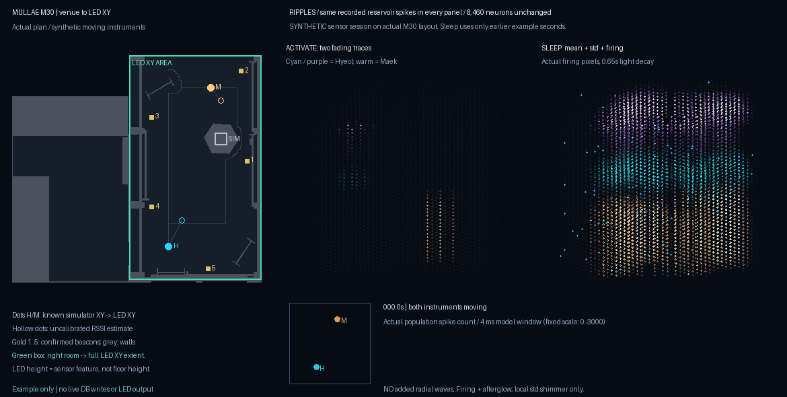
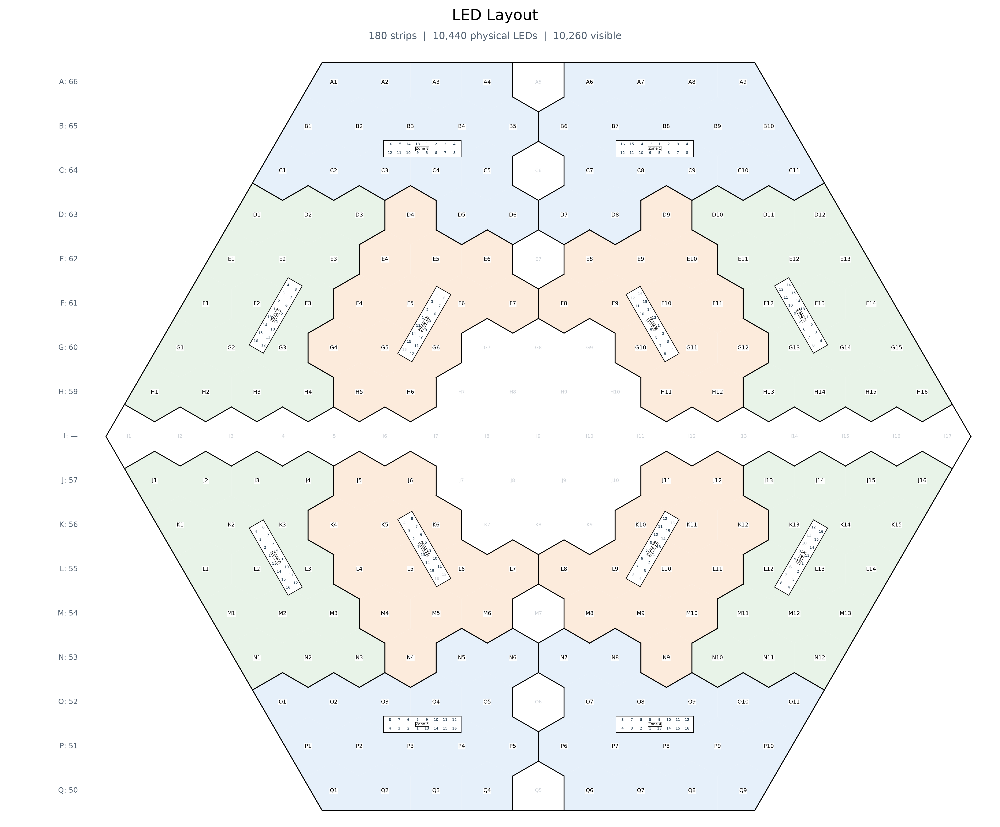

# 운영·재현 참고

설명 중심의 최신 문서는 [전체 소개](README.md), [혈](sensors/hyeol-pi/README.md),
[맥](sensors/maek-pi/README.md), [심탑](src/ripples/README.md)에 있습니다.
이 문서는 이전 실행 예제를 모아 둔 참고 자료입니다. 전시 live의 기본은 시간표(20분/10분)이며
아래 기록 재생 CLI의 수동 상태 선택과 구분합니다. 실제 송출 전 보드 확인을 유지합니다.

**혈의 거리 정보와 맥의 소리 정보를 위치별로 기록하고, 심 LED 탑에 현재 감각과
누적된 공간 기억을 표현하는 프로젝트입니다.** 8,460개 spiking neuron의 실제 발화와
센서의 공간 통계를 함께 사용합니다.



위 GIF는 **M30의 실제 평면·벽 배치·확정 비콘 5개**를 반영한 68초 예시입니다.
이동·라이다·마이크·RSSI는 모두 명시적으로 표시한 **합성 예시 데이터**이며,
8,460 뉴런의 기존 실제 발화 기록을 사용합니다. **추가 방사형 파동은 없습니다.**

왼쪽은 전시장 지도, 가운데는 Activate의 현재 흔적, 오른쪽은 Sleep의 이전 관측
평균·표준편차와 발화·잔광입니다. 지도에서 채워진 H/M은 LED에 대응되는 시뮬레이션 위치,
빈 원은 별도로 계산한 RSSI 추정 위치입니다. 마지막 8초에는 Activate가 사라집니다.
예시 기억은 임시 공간에서만 만들며, 현장 데이터 누적은 여전히 OFF입니다.

[명확한 데이터 폼·필드·단위·예제](data_led_example/m30_session/README.md)와
[JSON Schema](data_led_example/m30_session/event.schema.json),
[재생 결과](docs/media/m30_active_sleep.json)를 함께 제공합니다.
이전 [실제 혈 기록 예시](docs/media/dream_activity.gif)와 [3화면 파동 비교](docs/media/dream_compare.gif)는 참고 자료입니다.

## 현재 구현 범위

- 기록 파일 읽기 → 특징 추출 → RSSI 위치 데모 → 공간 통계 → RGB565 송출까지 구현했습니다.
- 센서 기록이 추가되면 `--watch`로 가져와 평균·분산을 갱신할 수 있습니다.
- `ripples.live`는 실행 중인 센터의 실제 ToF·거리·맥·비콘 입력을 읽어 심 탑에서 처리합니다.
  Pi 원시 ToF/PCM을 직접 받을 TCP 경로도 제공합니다. [실시간 연결·규격](docs/realtime.md)
- M30의 **확정된 비콘 5개 좌표**를 기본 설정 `configs/live.m30.json`에 반영했습니다.
  상대 RSSI 위치 추정은 준비됐으며 1m 기준 RSSI는 아직 미보정입니다.
- **현재 운영 범위는 수신·연결성 점검만**입니다. `ripples.receive`는 DB·신경망·LED를 열지 않습니다.
  [수신 전용 실행과 데이터 폼](docs/RECEIVE_ONLY.md)을 먼저 참고하세요. 누적은 기본으로 꺼져 있습니다.
- `activity`는 실제 발화한 뉴런의 빛과 잔광입니다. `slow_waves`의 방사형 모양과
  std 기반 아른거림은 **추가 시각 효과**이며, 자연적인 공간 파동이나 임계성의 증명은 아닙니다.
- 이 저장소 정리 과정에서 실제 LED에 새로 송출하거나 펌웨어를 갱신하지 않았습니다.

## 설치와 가장 빠른 실행

Python 3.11 이상. 저장소를 clone한 뒤 **editable 설치**합니다. 배치·예시 데이터는
저장소의 `data_led_example`에서 읽으므로 이 폴더도 함께 유지하세요.

```powershell
git clone https://github.com/skynot0625/2026_Ripples.git
cd 2026_Ripples
python -m venv .venv
.\.venv\Scripts\python.exe -m pip install -e ".[test]"

# 현재 권장 예시: M30 배치 + 명시적인 합성 데이터 폼 + Activate/Sleep
.\.venv\Scripts\python.exe -m ripples.venue_example
# 결과: docs/media/m30_active_sleep.gif (현장 DB 접근·LED 송출 없음)

# 이전 실제 혈 기록 기반 예시도 별도로 사용 가능
.\.venv\Scripts\python.exe -m ripples.demo

# 제공된 혈 기록만 60초 재생 / USB를 열지 않음
.\.venv\Scripts\python.exe -m ripples --reservoir recorded --seconds 60 --preview outputs/hyeol.gif
```

macOS/Linux는 `.venv/bin/python`을 사용합니다. Windows에서는 설치 후
`scripts/preview.cmd`를 실행해도 됩니다. 최초 설치 후 데이터와 의존성이 로컬에 있으면
인터넷 없이 실행할 수 있습니다. 실제 모델은 float64 가중치 행렬을 사용하므로 RAM 수 GB가 필요합니다.

M30 예시는 `scripts/example-m30.cmd`로도 만들 수 있습니다. 정규화 폼은 양쪽 기구 모두
`schema/example/session_id/source/seq/t_ms/position/measurement`를 사용하며,
JSONL 4,800개와 원래 네트워크 형태의 샘플을 제공합니다. 오른쪽 전시실을 LED 수평면 전체에
맵핑하고 로비는 제외합니다. Sleep에는 이미 끝난 구간만 누적합니다.

## 테스트 화면과 실시간 실행

| 이 PC에서 여는 주소 | 용도 |
|---|---|
| [시각화 작업실](http://127.0.0.1:8000/?test) | 센서 시각화 레이어·프리셋 편집, 기구/블라인드 출력 배정 |
| [연결 관리](http://127.0.0.1:8000/operator?test) | 카메라·거리·맥·비콘 연결, 수신 빈도와 오래된 입력 점검 |

두 페이지는 별도 센터 프로그램 `tof-web-viewer`가 제공하며, **`?test`는 점검/편집 UI 옵션**입니다.
가상 센서 모드를 뜻하지 않습니다. 다른 PC에서는 `127.0.0.1` 대신 센터 PC의 공유기 내 IP를
사용합니다. 인터넷이 없어도 같은 LAN에서 연결할 수 있지만 공유기와 PC 전원은 필요합니다.

```powershell
# 현재 권장: 센터가 실행 중일 때 LAN 센서 데이터 수신을 30초 점검
.\.venv\Scripts\python.exe -m ripples.receive --seconds 30
# 상태: runtime/receiver-status.json (고정 파일 갱신, 데이터 이력/DB 누적 없음)

# 계속 수신만 / Ctrl+C로 종료 / 신경망 계산·LED 송출·DB 없음
.\.venv\Scripts\python.exe -m ripples.receive --seconds 0

# 추후 표시를 켤 때: 보드 확인 후 송출, 이 명령도 누적은 꺼져 있음
.\.venv\Scripts\python.exe -m ripples.live --port COM3 --seconds 0
```

`scripts/receive.cmd`와 `scripts/live-site.cmd`는 계속 수신만, `scripts/live-check.cmd`는 30초 점검입니다.
표시 앱 `ripples.live`도 `--accumulate`를 명시한 경우에만 공간 DB를 엽니다. 전시 표시 앱의 기본 상태는 한국 시각 11시 기준 20분/10분 시간표입니다.
`--state-mode manual` 또는 명시적 `--state`에서만
`scripts/activate.cmd`, `scripts/sleep.cmd`를 사용합니다. 실시간 입력에서도
Activate는 새 관측에만 흔적을 찍고, 누적을 켠 경우 Sleep은 mean/std와 기존 criticality를 표시합니다.
센터의 기구 부착 상태는 현재 모의 값이므로 자동 상태 전환 신호로 쓰지 않습니다.

실제 센터 입력+live reservoir로 **PC 프레임 루프 약 9.90 FPS**를 확인했습니다.
좌표 미보정 상태의 15초 진단이며, LED 보드 FPS 측정은 아닙니다.
실행 스크립트와 기본 미리보기는 `activity`(추가 파동 없음)입니다.
현재 맥 실시간 메시지의 3채널 정규화 음량은 높이·밝기가 함께 커지는 세 기둥으로 표현합니다.
원시 PCM을 받으면 기존 저·중·고음 표상을 사용합니다. 두 입력 단위를 혼동하지 않습니다.

확정 좌표는 [M30 위치 설정](docs/realtime.md#확정된-m30-좌표와-대략적인-위치)에 있습니다.
신선한 비콘이 3개 미만이면 좌표를 만들거나 기억을 갱신하지 않습니다. 2026-11-20 마지막
점검 때는 일부 비콘만 켜져 있었고 맥 입력은 없었으므로, 모두 켠 뒤 두 기구의 동시 수신을 확인하면 됩니다.

## Activate와 Sleep

| 항목 | Activate | Sleep |
|---|---|---|
| 위치 | 각 감각기구의 현재/최근 XY | 관측한 공간 셀의 XY |
| 데이터 | 현재 센서 특징 | 해당 위치의 평균과 표준편차 |
| 표상 규칙 | 거리·주파수·밝기 변환 공통 | 동일한 기본 변환 |
| 시간 표현 | 흔적이 나타나고 지수적으로 소멸 | 이동 흔적 없이 공간 기억 유지 |
| reservoir | 내부 계산은 계속, 표시하지 않음 | 실제 발화 또는 발화가 유발한 느린 효과 |
| 보존 | 공간 통계에 누적 | 공간 통계에 누적 |

혈과 맥은 각각 **한 위치에 묶인 표상**입니다. 카메라 9개 영역이나 마이크 3채널을
각각 별도의 이동체로 그리지 않습니다.

| 입력 | LED 표상 |
|---|---|
| 혈·맥 비콘 위치 | LED 수평 X, Y |
| 혈 라이다 카메라 | 회전 보정 후 3×3 청록색 거리 지형. 가까우면 낮게, 멀면 높게 |
| 혈 위쪽 라이다 **1개** | 혈 XY 중심의 보라색 선과 거리 끝점 |
| 맥 저음 `<400Hz` | 낮은 층의 호박색, 대역 에너지에 따른 밝기 |
| 맥 중음 `400–2,000Hz` | 가운데 산호색 |
| 맥 고음 `≥2,000Hz` | 높은 층의 분홍·자홍색 |

높이는 센서 특징의 표현 축입니다. 카메라의 실제 세계 자세나 음원의 방향을 복원한 결과가
아닙니다. 상세 규칙과 파일 규격은 [센서·공간 기억 문서](docs/sensing.md)에 있습니다.

## 심 LED 탑 — 현재 설치 기준

**2026-11-12 인계본 기준**입니다. 현재 펌웨어는 RGB565 / **LED2**, 기존에 설치된 상태를
전제로 합니다. 이전 55슬롯 모델 주소와 실제 탑의 65슬롯 송출 주소를 구분해야 합니다.

| 항목 | 값 |
|---|---|
| 중앙 보드 | Nano ESP32 / ESP32-S3 1개, CPU 240MHz |
| 분배 | MUX 보드 12개 × 채널 16개, 연결 스트립 **180개** |
| 물리 LED | **10,440개** |
| 가시 LED | **10,260개** — 각 스트립 첫 물리 LED는 검정 |
| reservoir 뉴런 | **8,460개** = E 6,768 + I 1,692 |
| 모델 RGB 배열 | `(12,16,55,3)` uint8, 빈 주소는 0 |
| 설치 RGB 배열 | `(12,16,65,3)` — 실제 길이에 맞춰 펼치고 나머지는 0 |
| 최대 스트립 길이 | 물리 66 / 가시 65 |
| 매핑 | Zone1→DD0 … Zone12→DD11, C1→MUX0 … C16→MUX15 |
| 색상 | PC에서 지정 **34개 스트립 R/G 교환**, 파랑 유지. 보드는 GRB 출력 |
| 밝기 | MCU에서 32/255 적용. PC에서 같은 밝기를 다시 곱하지 않음 |
| 공간 배치 | 스트립 간격 12cm, LED 간격 5cm, 하단 기준 높이 50cm, 상부 기울기 약 28.759° |

뉴런 수는 그대로 두고, 각 스트립의 모델 픽셀을 새 길이에 **최근접 복제**해 펼칩니다.
따라서 가시 LED 10,260개가 서로 독립적인 뉴런 10,260개를 뜻하지 않습니다.



배치 CSV의 `position_id`, `zone`, `port_c`, `led_count`, `visible_led_count`가 주소 변환의
기준입니다. [배선도](data_led_example/layout/wiring.png), [GPIO·커넥터·프로토콜](docs/tower.md),
[원본 하드웨어 인계 문서](data_led_example/hardware_reference/HARDWARE_CURRENT.md)를 함께 확인하세요.
CSV의 일부 현장 설치 상태는 `unconfirmed`/`proposal`이므로 접점 방향과 실제 배선은 현장에서 대조합니다.

## 실제 LED 실행

```powershell
# 포트 목록 확인
.\.venv\Scripts\python.exe -m serial.tools.list_ports

# 실제 reservoir를 계산하며 연속 송출 (COM3는 예시)
.\.venv\Scripts\python.exe -m ripples --port COM3 --seconds 0 --reservoir live --state activate

# Sleep: 실제 발화만 + 평균/std
.\.venv\Scripts\python.exe -m ripples --port COM3 --seconds 0 --state sleep --criticality activity

# Sleep: 같은 발화에 느린 방사형 효과 추가
.\.venv\Scripts\python.exe -m ripples --port COM3 --seconds 0 --state sleep --criticality slow_waves
```

송신 전 포트 정보가 표시되고 **포트명을 다시 입력해 보드를 확인**합니다. USB를 여는
것만으로 자동 송출하지 않습니다. 시작 시 검정 프레임의 ACK/CRC를 확인하고,
정상 종료 시 대기 ACK를 처리한 뒤 검정 프레임을 확인합니다.

실행 중 상태는 `runtime/state.txt`의 `activate`/`sleep`으로 바꿉니다.
Windows에서는 `scripts/activate.cmd`, `scripts/sleep.cmd`, `scripts/stop.cmd`를 사용합니다.
Ctrl+C도 소등 절차를 수행합니다. USB를 물리적으로 뽑는 것은 소등 명령이 아니며 마지막 색이 남을 수 있습니다.

합성 맥까지 송출하려면 먼저 `python -m ripples.demo`를 실행한 뒤 아래 입력/DB를 사용합니다.

```powershell
.\.venv\Scripts\python.exe -m ripples --data-dir runtime/dream-demo/input --db runtime/dream-demo/dream.sqlite3 --port COM3 --seconds 0 --state sleep
```

혈 기록은 약 59초, 합성 맥은 240초입니다. 전체 기록 후반에 혈 데이터가 없으면 새 혈 신호를 만들지 않습니다.
공유 GIF는 둘이 함께 있는 첫 바퀴와 소멸 구간을 보여 줍니다.

## 프레임·모델 시간·파동

- `dt=0.1ms`, 프레임당 **40스텝** = 모델 4ms. 표시 목표 10FPS에서 모델 1초는 표시 약 25초입니다.
- gain **9.5**, seed **0**, `p_scale=0.2×999/8459`. 센서 효과가 모델 가중치/입력으로 되먹임되지 않습니다.
- `activity`(기본): 실제 발화 픽셀과 0.65초 잔광. 전체 LED를 강제로 동시에 켜지 않습니다.
- `slow_waves`: 같은 발화에 burst 반응형 방사형 효과. 기존 시각 효과의 0.30배 속도입니다.
- `legacy_waves`: 종전 빠른 효과 비교용. `--dream-strength 0`은 std 흔들림을 끕니다.
- RGB565 프레임은 24,980바이트. Windows 64바이트 분할 쓰기 + 최대 2프레임 in-flight + 다음 계산 1프레임 예열을 사용합니다.
- 이전 실제 설치의 ACK 기준 관측은 약 **8.1FPS**였습니다. 이 저장소의 PC 미리보기 속도가
  현재 보드 FPS를 보장하지 않으며, 실제 연결 시 출력 완료 ACK로 확인해야 합니다.

모델이 집단 발화를 보여도 그것만으로 통계적 임계성이나 멱법칙을 증명하지 않습니다.
원본 reservoir 및 변경 출처는 [NOTICE](NOTICE.md)에 기록했습니다.

## 누적 통계와 용량

24×24 공간 셀에 센서별 평균·M2·관측 수를 저장합니다. 먼저 같은 셀/특징의 1초 평균을
만들어 50Hz 거리 센서가 10Hz 카메라보다 단순히 5배 가중되지 않게 합니다.
std는 이 **1초 평균들의 표본 표준편차**입니다. 2회 미만 관측은 흔들림을 만들지 않습니다.
평균±std의 표상 차이에 1.8초 시간상수의 부드러운 잡음을 곱해 국소적으로 아른거리게 합니다.

SQLite 트랜잭션/WAL, 최근 30일 통계 + 평생 누적 통계, 재생/재시작 중복 방지를 사용합니다.
DB 한도 256MiB, 기록/세션 키 한도 10,000개, 디스크 여유 512MiB 미만은 새 가져오기를
오류로 중단합니다. 기존 통계는 삭제하지 않습니다. WAL과 입력 원본은 이 DB 한도와 별도입니다.

- 공유 혈 ZIP 약 32.6MB, 비교 GIF 약 24.8MB. 설치 배치/배선 자료와 스파이크 예시는 함께 제공합니다.
- 전체 합성 WAV 240초 약 63.5MB는 **로컬 생성**합니다. 저장소에는 1초 예시만 포함합니다.
- 로컬 꿈 데모 DB 약 0.28MB. 생성 DB·로그·미디어는 `.gitignore`로 제외합니다.
- 원본 음성을 계속 저장하면 약 22.86GB/일, ToF 10Hz 원본은 약 149.30GB/일입니다.
  이 앱은 원본을 자동 녹화하거나 사용자 입력 폴더를 삭제하지 않습니다.

## 코드와 자료 구조

```text
src/ripples/                센서·통계·표상·실행 CLI
  live.py / realtime.py    센터 읽기, 원시 TCP, PC 전처리, 실시간 누적
  hardware/                RGB565 인코더, USB 송신, 보드 확인
src/snnrc/                 실제 E/I reservoir 및 분석 코어
data_led_example/
  layout/                  현재 배치 CSV/JSON, 배치도·배선도
  hardware_reference/      제공받은 하드웨어 인계 문서
  firmware_reference/      설치 펌웨어 소스·바이너리·빌드 기록·패치
  sensors/                 실제 혈 ZIP, 비콘/마이크 규격
  audio_synthetic_sample/  합성 3채널 WAV 1초 + metadata
  spikes/                  기존 모델의 실제 스파이크 NPZ
  m30_session/             M30 실제 배치 + 명시적 합성 이벤트/스키마/통신 폼/manifest
docs/                      설명 및 공유 GIF
configs/live.example.json 비콘 좌표·RSSI 보정·실시간 입력 설정 양식
configs/live.m30.json     확정된 M30 비콘 5개 / 상대 RSSI 위치 / 별도 estimated 누적
scripts/                   Windows 실행·상태 전환
tests/                     reservoir·센서·USB 경계·패키지 테스트
runtime/                   로컬 DB/생성 음성/상태 (Git 제외)
outputs/                   로컬 새 미리보기 (Git 제외)
```

`data_led_example/firmware_reference`는 **참고 자료**입니다. 앱은 펌웨어를 자동으로
플래시하지 않습니다. 과거 55슬롯 핀마스크/인코더와 현재 65슬롯 LED2를 혼용하지 마세요.

## 검증

```powershell
.\.venv\Scripts\python.exe -m pytest -q
.\.venv\Scripts\python.exe -m ripples --reservoir recorded --seconds 2
```

[검증 기록](docs/validation.md)에 전체 테스트 결과, 이전 하드웨어 실측과 이번 오프라인
검증의 범위를 구분해 기록합니다. [requirements-tested.txt](requirements-tested.txt)는 검증 PC의
의존성 버전 기록이며, 일반 설치는 `pyproject.toml`의 범위를 사용합니다.

## 감각기구 쪽 코드와 데이터 흐름 (2026-11-20)

혈, 맥, 비콘 수신기가 센서를 읽고 처리해 공유기로 보내는 코드와, 전시컴 서버 전체를 추가했습니다. 각 기구가 받는 형식, 처리, 보내는 형식, 심탑이 전시컴에서 읽는 형식과 남은 일은 [감각기구 데이터 흐름](docs/DATA_FLOW.md)에 있습니다.

| 폴더 | 내용 |
|---|---|
| `sensors/hyeol-pi` | 혈 Pi: ToF 카메라와 천장 거리 수집, 저장, 전시컴 송신 (TCP 9500) |
| `sensors/maek-pi` | 맥 Pi: Teensy 마이크 3채널 수신, 소리 처리, 스피커와 진동모터, 전시컴 송신 (`/api/maek`) |
| `sensors/beacon` | BLE 비콘 수신기 (혈, 맥 Pi 공용, `/api/beacon`) |
| `exhibition-server` | 전시컴 서버 전체: 센서 수신, 기구 화면과 블라인드 출력, 갤러리 3D 시뮬레이터, 연결 관리 |
