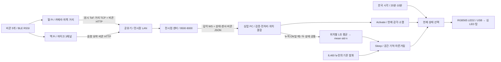
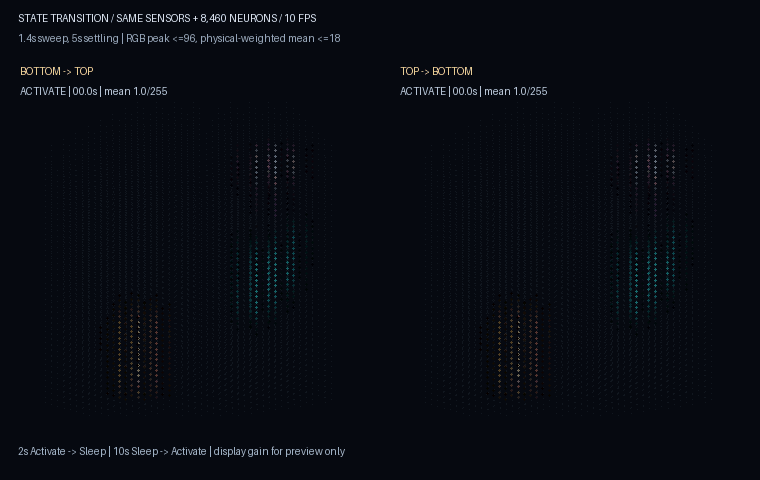

# 2026 Ripples — 혈·맥·심

혈은 공간의 **거리**, 맥은 공간의 **소리**를 감각합니다. 두 기구가 받은 비콘 RSSI로 위치를 추정하고, 심 LED 탑은 그 위치에 현재의 감각과 누적된 공간 기억을 표현합니다.

| 구성 | 설명 |
|---|---|
| [감각기구 — 혈](sensors/hyeol-pi/README.md) | 원시 ToF 카메라·위쪽 거리 1개·비콘 → 거리 지형 |
| [감각기구 — 맥](sensors/maek-pi/README.md) | 마이크 3채널·비콘 → 현재 음량, 원음 수신 시 주파수별 표상 |
| [심탑](src/ripples/README.md) | 실시간 수신·전처리·정규화·공간 통계·시간표·LED 출력 |
| [전체 데이터 흐름과 네트워크](docs/DATA_FLOW.md) | 실제 경로와 선택 가능한 원시 입력 경로, 포트·시간·결측 처리 |

## 전체 흐름

센서가 신경망 가중치를 바꾸는 구조가 아닙니다. **센서 표상과 기존 발화를 마지막 화면에서 합성**합니다. 8,460개 뉴런, gain 9.5, dt 0.1ms, 프레임당 40스텝을 유지하며, 추가 방사형 파동은 기본 OFF입니다.

## 문래 M30 전시장 예시

왼쪽은 전시장 지도, 가운데는 Activate, 오른쪽은 Sleep입니다. **실제 M30 벽·가구 배치와 확정 비콘 5개 좌표**를 사용하고, 이동·거리·마이크·RSSI는 모두 **합성 예시**입니다. 벽을 피하는 46.2m 경로에서 혈·맥이 반 바퀴 간격으로 움직입니다.

채워진 H/M은 예시의 알려진 위치로 LED에 대응하고, 빈 원은 상대 RSSI 추정 위치입니다. 실제 운전에서는 알려진 위치를 얻을 수 없으므로 RSSI 추정을 사용합니다. 로비를 제외한 **오른쪽 전시실 전체**를 LED 수평면 전체에 대응합니다. 지도 초록 상자가 이 범위이며, 같은 이동 경로가 기존 전체 지도 대응보다 X축 약 1.89배 넓게 펼쳐집니다. 물리 탑의 방위 보정은 별도입니다.

Sleep은 앞서 관측한 3바퀴의 평균·표준편차에 8,460 뉴런의 실제 발화 기록을 합성합니다. 마지막 8초에는 입력이 멈추어 Activate 흔적이 사라집니다. GIF는 **68초의 나란히 비교**이며 실제 전시의 30분 시간표를 압축 재생한 것은 아닙니다. 렌더 10Hz, 공유 GIF 5FPS입니다.

[데이터 폼과 단위](data_led_example/m30_session/README.md) · [JSON Schema](data_led_example/m30_session/event.schema.json) · [검증 결과](docs/media/m30_active_sleep.json)

## 전시장 3D 심탑에서 예시 보기

[venue3d?test](http://127.0.0.1:8000/venue3d?test)의 **심탑 · 센서 맵핑 예시**에서 Activate/Sleep을 바꿔 볼 수 있습니다. **시점 → 심**으로 가까이 보고, 일시정지·시간 슬라이더로 같은 순간을 비교하세요. 전시 시간표 버튼은 한국 시각의 20분/10분 주기를 따릅니다. 예시 재생은 실제 센서나 USB 출력을 바꾸지 않습니다.

[개선한 감각별 맵핑과 3D 캡처](docs/SENSOR_MAPPING.md) — 청록 거리 면 / 상단 보라 천장 표식 / 따뜻한 음량 기둥.

## 전시 시간표 — Activate 20분 / Sleep 10분

**한국 시간 오전 11:00 기준**, 30분 주기를 반복합니다. 심탑 표시 앱은 매 프레임 PC의 실제 시각에서 상태를 계산하므로, 늦게 시작하거나 재시작해도 시간표가 밀리지 않습니다.

| 한국 시각 | 상태 | 표시 |
|---|---|---|
| 11:00 ≤ 시각 < 11:20 | Activate | 혈·맥의 현재 위치에 감각을 찍고 점점 소멸 |
| 11:20 ≤ 시각 < 11:30 | Sleep | 위치별 mean/std와 기존 발화·잔광 |
| 11:30 ≤ 시각 < 11:50 | Activate | 새 관측의 흔적 |
| 11:50 ≤ 시각 < 12:00 | Sleep | 누적된 기억 |
| 이후 | 동일 주기 | 매시 :00/:30 Activate, :20/:50 Sleep |

전환 때 **센서 연결·전처리·신경망·누적 작업을 재시작하지 않습니다.** 표시만 바뀝니다. 누적 ON 운전에서는 Activate에도 Sleep에도 관측을 저장하며, Sleep에 현재 이동 흔적을 직접 겹치지 않습니다. 아직 폐장 시간이 없으므로 자동 종료는 없고 실행 중에는 야간에도 동일 주기입니다. 11시 이전 실행도 같은 주기의 이전 구간을 따릅니다.

시간표는 [schedule.m30.json](configs/schedule.m30.json), 구현은 [schedule.py](src/ripples/schedule.py)입니다. 전시 표시 앱 `ripples.live`의 기본은 시간표·연속 실행입니다. 명시적인 수동 모드만 기존 state 파일을 읽으므로 예전 수동 파일이 시간표를 덮어쓰지 않습니다. `ripples.receive`는 수신 점검용이어서 표시 상태가 없습니다.

**현장 누적 OFF 설정은 유지**했습니다. 현재 점검은 수신 전용이며, 전시에서 공간 기억을 쓸 때는 누적 ON 운전을 선택합니다. 누적 OFF이면 Sleep에는 공간 기억 없이 신경망 발화만 보입니다. 예시 데이터는 임시 DB에서만 처리합니다.

## 같은 데이터, 두 가지 시간 표현

| 신호 | 두 상태의 공통 표상 | Activate | Sleep |
|---|---|---|---|
| 혈·맥의 위치 | LED 수평 XY | 각각 현재 위치 | 관측된 공간 셀 |
| 혈 카메라 | 청록색 3×3 연결 면, 가까운 거리 차이를 확대 | 최신 영역값 | 영역별 평균·변동 |
| 혈 위쪽 거리 1개 | 혈 XY 상단의 보라 기둥·가로 표식 | 최신 거리 | 평균 거리·변동 |
| 맥 현재 음량 3채널 | L/C/R 세 음량 기둥, 음량→높이·밝기 | 최신 L/C/R | 채널별 평균·변동 |
| 맥 원시 PCM 선택 경로 | 저·중·고 대역의 높이·색·밝기 | 최근 음향 특징 | 선형 전력 평균·변동 |
| 시간 | 동일 단위·동일 밝기 변환 | 약 0.9초 시간상수로 감쇠 | std에 따른 느린 국소 흔들림 |

거리의 표시 높이는 실제 공간 높이를 복원한 것이 아닙니다. 맥 L/C/R 음량은 저·중·고 주파수가 아니며 원음 없이 주파수를 만들어내지 않습니다. std 흔들림은 변동성을 표현하는 시각 효과이고, 임계성의 증명은 아닙니다.

## 심탑 하드웨어와 현재 범위

180개 스트립, 물리 LED **10,440개**, 가시 LED **10,260개**입니다. 모델의 8,460개 출력을 실제 스트립 길이에 펼쳐 RGB565/LED2로 보냅니다. 프레임은 24,980바이트, 목표는 8–10FPS이며 실제 출력 완료는 보드 ACK로 확인합니다. 과거 ACK 관측은 약 8.1FPS였고 이번 예시의 PC 렌더 속도와는 다릅니다.

[심탑 구조·배선·프로토콜](docs/tower.md) · [검증 기록](docs/validation.md)

전시컴의 [시각화 작업실](http://127.0.0.1:8000/?test)과 [연결 관리](http://127.0.0.1:8000/operator?test)는 기존 센터의 진단 화면입니다. `?test`는 가상 데이터 모드가 아닙니다. 다른 PC에서는 전시컴 LAN IP를 사용합니다. 인터넷 없이도 공유기 내부 통신은 가능합니다.

현재 맥 Pi는 음량 요약을 송신하며, raw PCM 송신은 별도 연결이 필요한 선택 경로입니다. 일부 비콘만 켜져 있으면 유효 위치를 만들지 않습니다. 이번 코드/예시는 USB 송출이나 Pi 재배포를 수행하지 않습니다.

상세 실행 참고는 [운영 자료](OPERATIONS.md), 기존 수신 전용 정책은 [수신 점검 문서](docs/RECEIVE_ONLY.md), 원본 모델 출처는 [NOTICE](NOTICE.md)에 있습니다.

### 상태가 바뀔 때의 빛

[전환 방향 비교와 밝기 제한](docs/STATE_TRANSITIONS.md): 아래→위 / 위→아래를 같은 센서 구간에서 비교합니다.
[3D 심탑](http://127.0.0.1:8000/venue3d?test)의 **비교 아래→위 / 비교 위→아래** 버튼으로 18초 예시를 재생합니다.

