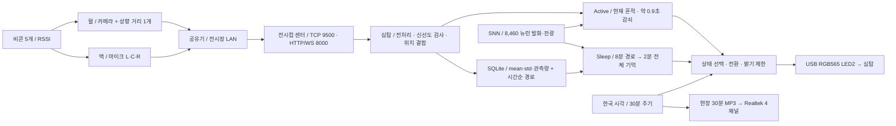
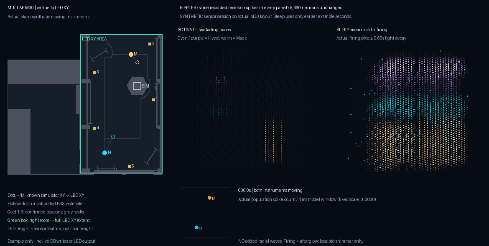

# 2026 Ripples — 혈·맥·심

[Notion · 심탑 운영과 관람 해설](https://app.notion.com/p/42361536c31881eabbdfed1df27e2dba?pvs=204)

〈심〉은 이동하는 감각기구가 만난 공간을 빛으로 다시 읽는 탑입니다. 현재의 감각은 잠깐 나타났다 사라지고, 축적한 감각은 Sleep에서 경로와 공간의 기억으로 드러납니다. 8,460개 스파이킹 뉴런의 활동이 두 상태에 함께 흐릅니다.

**2026-11-25 문래 M30 현장 기준.** 위→아래는 **천장 라이다 / 소리 / 라이다 카메라**, 모두 흰색입니다. 센서 표상과 SNN 활동을 최종 화면에서 합성합니다. 센서가 현재 신경망의 가중치를 학습시키는 구조는 아닙니다.

| 읽을 내용 | 문서 |
|---|---|
| 일반인·연구자·미술인 관점의 Q&A | [심탑 전시 해설](docs/EXHIBITION_GUIDE.md) |
| SNN·criticality·Sleep의 과학적 근거와 구현 범위 | [과학과 작품의 연결](docs/SCIENCE_AND_QA.md) |
| 현재 현장에서 실행되는 것 | [현장 운영 기준](docs/EXHIBITION_RUNTIME.md) |
| 감각기구 — 혈 | [거리 획득·송신](sensors/hyeol-pi/README.md) |
| 감각기구 — 맥 | [마이크 획득·송신](sensors/maek-pi/README.md) |
| 심탑 | [수신·전처리·기억·출력](src/ripples/README.md) |
| 전체 연결과 데이터 계약 | [데이터 흐름](docs/DATA_FLOW.md) · [필드·단위](docs/realtime.md) |
| 빛과 소리 | [감각별 맵핑](docs/SENSOR_MAPPING.md) · [음향 구현과 예시](docs/TOWER_AUDIO.md) |

## 감각에서 빛까지

카메라 회전·confidence 처리는 PC 센터에서, 3×3 영역 특징 추출과 표상은 심탑 프로그램에서 수행합니다. 현재 맥은 음량 요약을 보냅니다. **PCM 원음 수신 선택 경로**에서만 대역 전력·스펙트럼 중심 주파수를 구합니다. 음량만으로 주파수나 문장을 복원하지 않습니다.

상대 RSSI로 대략적인 위치를 추정하며 신선한 비공선 비콘이 3개 이상 필요합니다. 위치가 없으면 수신은 계속하지만 공간 기억에 임의 좌표를 넣지 않습니다. 오른쪽 전시실 X[-0.462,11.149], Y[0.090,19.851]m를 LED 수평면 전체에 대응합니다.

## 오늘의 시간표

한국 시각 **10:30 기준**, Active 20분 → Sleep 경로 재현 8분 → Sleep 전체 기억 2분을 반복합니다. 시작 포함·끝 제외이며 재시작하면 현재 시각의 구간으로 돌아갑니다.

| 시각 | 상태 | 보이는 것 |
|---|---|---|
| 10:30–10:50 | Active | 현재 위치의 감각 흔적, 약한 SNN 활동 |
| 10:50–10:58 | Sleep · 경로 | 보존된 경로를 시간순으로 따라가며 위치별 평균·변동 표시 |
| 10:58–11:00 | Sleep · 전체 | 관측된 모든 위치의 평균·변동 유지 |
| 11:00–11:20 | Active | 다음 주기 |
| 이후 | 30분 반복 | :00/:30 Active, :20/:50 Sleep, :28/:58 전체 기억 |

현장 일일 컨트롤러의 운영 창은 **10:30–19:00**입니다. 기본 `ripples.live` 자체에는 폐장 제한이 없고 컨트롤러가 종료를 담당합니다. 상태 전환은 표시만 바꾸며 수신·누적·SNN을 재시작하지 않습니다. 양방향 모두 중앙의 넓은 바닥에서 시작해 위로 퍼지는 5초 흰색 전환을 사용합니다.

## 같은 감각, 다른 시간

| 위치 | 공통 흰색 표상 | Active | Sleep |
|---|---|---|---|
| 상단 · 혈 천장 거리 | 위에서 내려오는 국소 면, 2.2m 주변 굴곡 확대 | 현재 거리 | 위치별 평균·std |
| 중단 · 맥 소리 | 음량은 밝기·두께, 주파수 중심값이 있으면 띠 높이·느린 맥동 | 최신값과 잔상 | 평균 주파수·음량과 std |
| 하단 · 혈 카메라 | 바닥에서 올라오는 3×3 기둥·연결면, 로그 거리 축 | 현재 거리 지형 | 영역별 평균·std |

높이 32–40%, 68–76%에 분리 간격을 둡니다. 높이는 실제 전시장의 z축 복원이 아니라 감각 특징의 표현 축입니다. Sleep의 국소 잡음은 1초 관측 평균들의 std를 이용해 천천히 아른거리며 추가 방사형 파동은 사용하지 않습니다.

SNN은 6,768개 흥분성 + 1,692개 억제성 뉴런, gain 9.5, dt 0.1ms, 프레임당 40스텝을 유지합니다. Active에서는 발화 표시 밝기만 12%로 줄이고 1.5초 잔광을 사용합니다. 뉴런을 30%로 잘라내지 않습니다. **큰 점멸이나 oscillation만으로 임계성을 입증할 수는 없습니다.** [검증 범위](docs/SCIENCE_AND_QA.md)를 함께 읽어 주세요.

## 경로와 기억

상태와 무관하게 유효 관측을 저장합니다. 위치별 1초 평균을 먼저 만든 뒤 24×24 셀의 mean·M2·n을 갱신하고 기구별 초당 한 위치의 경로를 보존합니다. Sleep은 과거 경로로 현재 누적 통계의 표시 위치를 선택합니다. 당시 센서 원본 전체를 영상처럼 되감는 것은 아닙니다.

40시간 경로는 8분에 300배 압축됩니다. 재생 응답만 기구당 최대 9,600점으로 추리며 디스크 원본은 삭제하지 않습니다. 40시간×2기구=288,000개 위치 시험은 경로 테이블 약 7.5MiB였고 통계·WAL 사용량은 별도입니다. 각 DB 256MiB, 디스크 여유 512MiB 미만에서는 기존 기록을 지우지 않고 저장 오류를 보고합니다.

실측 추정 위치·합성 예시·3D DB는 분리합니다. 오늘 live는 `runtime/exhibition-live-estimated.sqlite3`, 별도 수신 아카이브는 `runtime/history-live-estimated.sqlite3`를 사용합니다. 두 DB가 자동 병합되지는 않습니다.

## 현장 음향과 예시

오늘 현장은 사용자 제공 **30분 MP3**의 앞 20분/뒤 10분을 LED 시간표와 맞춰 재생합니다. 스테레오 L/R을 1·3 / 2·4로 보내므로 현재 음악이 네 개의 독립 트랙인 것은 아닙니다. MP3는 저장소에 포함하지 않습니다.

Realtek **Quadraphonic 설정은 변경하지 않습니다.** 1=전면 좌측/전시장 안쪽, 2=전면 우측/입구쪽, 3=후면 좌측/길가 창문쪽, 4=후면 우측. 플레이어 배율 100%, 청취 음량은 앰프에서 조절합니다. [현장 설정](configs/audio.site-quad.json) · [1→2→3→4 테스트](data_led_example/tower_audio/site_quad/README.md).

별도로 LED 값 기반 Active 다성음, 원음 구간 추출·변형 Sleep 음향, 브라우저 미리듣기가 있습니다. 오늘의 MP3 재생과 동시에 자동으로 실행되지는 않습니다. [출처·선택 경로](docs/TOWER_AUDIO.md)를 참고하세요.

## 예시와 공간 3D

위 GIF는 **이전 색상 설계의 합성 비교 자료**입니다. M30 배치와 46.2m 이동 경로를 사용했지만 관측은 합성입니다. 최신 흰색·3층·8+2분 표상은 현재 코드와 3D 예시를 기준으로 합니다. [예시 데이터 폼](data_led_example/m30_session/README.md) · [JSON Schema](data_led_example/m30_session/event.schema.json).

| 테스트 화면 | 역할 |
|---|---|
| [/?test](http://127.0.0.1:8000/?test) | 센터 입력·작업실 |
| [/operator?test](http://127.0.0.1:8000/operator?test) | 연결 관리 |
| [/venue3d?test](http://127.0.0.1:8000/venue3d?test) | 공간 위치와 심탑 예시, 상태·음향 비교 |

같은 공유기의 다른 PC에서는 `127.0.0.1` 대신 심탑 PC의 LAN 주소를 사용합니다. M30 저장 설정은 `192.168.0.2:8000`이며 실제 할당 주소를 확인해야 합니다. `?test` 자체가 모든 입력을 가짜로 바꾸지는 않습니다.

3D 위치 연동은 혈·맥 XY를 사용하고 다른 감각값은 합성합니다. `/api/ripples-history`로 예시 기억·경로를 서버 DB에 보존하고 새로고침 후 복원합니다. 브라우저 미리보기와 실제 USB 송출은 별도입니다.

## 하드웨어와 확인 범위

논리 샘플 8,460개를 현장 스트립 길이에 맞춰 **180개 스트립·10,260개 표시 LED(물리 10,440개 중 스트립 첫 LED는 소등)**로 재표본화합니다. RGB565 LED2 USB 송신, 목표 10FPS이며 11월 25일 실제 송신 루프는 약 8.2FPS였습니다. 채널 최댓값 96/255, 물리 픽셀 가중 RGB 평균 18/255로 제한합니다. 이는 소프트웨어 밝기 제한이며 전류·온도 측정 결과는 아닙니다.

[검증 기록](docs/validation.md) · [현장 운영/소스 모드](docs/EXHIBITION_RUNTIME.md) · [하드웨어 상세](docs/tower.md) · [기존 설치·명령 참고](OPERATIONS.md).
