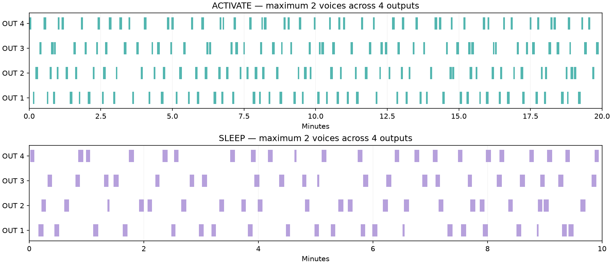

# 심탑 소리 예시 — Active 20분 / Sleep 10분

모든 소리는 이 프로젝트에서 합성했습니다. **Sleep도 실제 현장 녹음이 아니라 합성 맥 3채널 원음에서 발췌한 예시**입니다. 실제 녹음에는 같은 추출·변형 코드를 적용합니다.

| 용도 | Active | Sleep |
|---|---|---|
| 먼저 듣기 · 90초 | [MP3](activate_90s_preview.mp3) | [MP3](sleep_90s_preview.mp3) |
| 전체 · 스테레오 | [20분 MP3](activate_20min_stereo.mp3) | [10분 MP3](sleep_10min_stereo.mp3) |
| 실제 네 출력용 분리 채널 | [20분 4ch FLAC](activate_20min_4ch.flac) | [10분 4ch FLAC](sleep_10min_4ch.flac) |

파일 음량은 기본 master 0.22를 이미 적용했습니다. 각 출력의 이벤트 수는 Active 46/47/47/47, Sleep 21/21/21/22이며, 네 채널 전체 최대 두 소리만 겹칩니다. 예시 선택은 고정 seed로 재현합니다. MP3는 인코더의 작은 패딩이 있을 수 있고, FLAC은 정확히 1,200초/600초입니다.

## 데이터 폼

- `synthetic_source/audio.wav`: 48초, 44.1kHz, PCM16, 3ch. `metadata.json`에 `demo:true`와 SHA256.
- [manifest.json](../../exhibition-server/static/tower-audio/manifest.json): `ripples.tower-audio.v1`, 음량 정책, 시간표, 뱅크, 두 상태의 이벤트 계획.
- `bank[]`: `id`, `state`, `file`, `duration`(초), `source`. Sleep source에는 선택 마이크(1부터), 원본 sample rate, 각 원본 조각의 `file_frame/session_frame/frames`, 점수와 변형 배율이 있습니다.
- `plans.activate[] / plans.sleep[]`: `{id, start, duration, speaker, gain}`. 시간은 상태 시작부터 초, speaker는 **0–3**, gain은 master 이전 배율입니다. 잔향은 duration 안에 포함합니다.
- [bank WAV](../../exhibition-server/static/tower-audio/bank): 24kHz PCM16 모노. 실제 네 출력은 이벤트의 speaker로 정합니다.
- [validation.json](validation.json): 출력별 peak/RMS, 동시 발성 수, 파일 크기, 정확한 원본 길이.

전시 컴퓨터의 [공간 3D](http://127.0.0.1:8000/venue3d?test)에서도 상태별로 들을 수 있습니다. 이 주소의 `127.0.0.1`은 그 페이지를 여는 컴퓨터 자신을 뜻합니다.

[소리 설계·원음 연결·출력·용량 설명](../../docs/TOWER_AUDIO.md)
