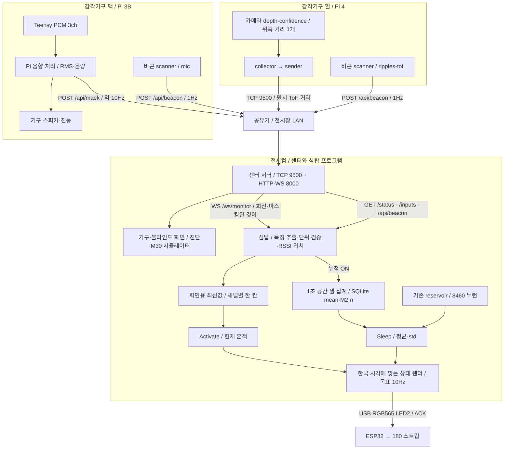
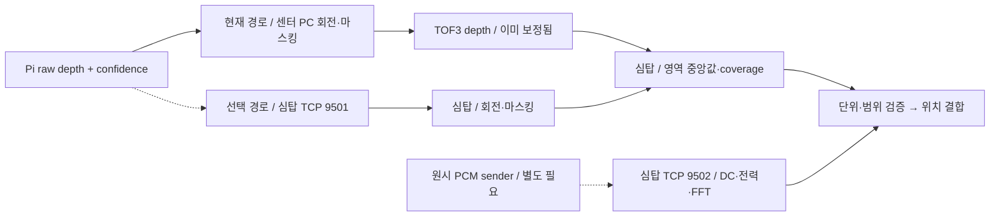
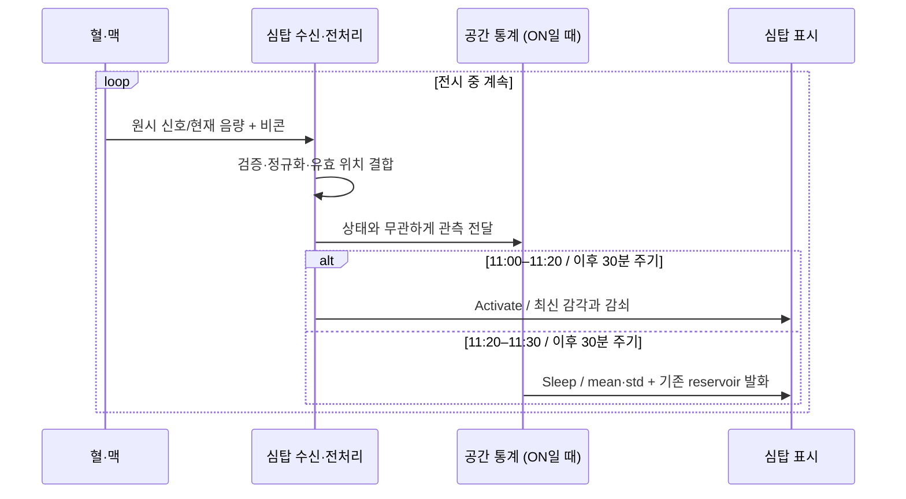

# 전체 데이터 흐름과 전시장 네트워크

[전체 소개](../README.md) · [혈](../sensors/hyeol-pi/README.md) · [맥](../sensors/maek-pi/README.md) · [심탑](../src/ripples/README.md)

## 지금 연결되는 경로

공유기는 데이터를 해석하지 않고 전달합니다. 센터와 심탑 프로그램은 **별도 프로세스**이며 현재 같은 전시컴에서 실행할 수 있습니다. 센터가 카메라의 기본 회전·confidence 마스킹을, 심탑이 3×3 특징 축약·통계·LED 표상을 수행합니다. 이 연산은 모두 PC 쪽입니다.

## 주소, 방향, 빈도

아래 IP는 저장소에 기록된 M30 설정입니다. 실제 할당이 달라지면 해당 설정을 맞춰야 하며 인터넷 공인 주소가 아닙니다.

| 발신 → 수신 | 네트워크 / 데이터 | 빈도 |
|---|---|---|
| 혈 Pi `192.168.0.4` → 전시컴 `192.168.0.2` | TCP 9500, hello 후 raw ToF/거리 | ToF 약 10Hz, 거리 약 50Hz |
| 혈 Pi → 전시컴 | HTTP 8000 `POST /api/beacon`, receiver `ripples-tof` | 약 1Hz |
| 맥 Pi `192.168.0.3` → 전시컴 | HTTP 8000 `POST /api/maek`, device `mic` | 약 10Hz |
| 맥 Pi → 전시컴 | HTTP 8000 `POST /api/beacon`, receiver `mic` | 약 1Hz |
| 심탑 → 센터 | `GET /status`, `/inputs`, `/api/beacon` | 한 묶음씩 목표 10Hz, 느리면 겹쳐 요청하지 않음 |
| 센터 → 심탑 | WS `/ws/monitor`, `next` 요청에 최신 TOF3 프레임 | 카메라 프레임에 맞춤 |
| 심탑 → LED 보드 | USB, RGB565 LED2 24,980B + ACK | 목표 8–10FPS |

같은 PC의 센터에는 `127.0.0.1:8000`, 별도 PC이면 센터의 LAN IP를 사용합니다. 인터넷 연결이 끊겨도 LAN은 동작할 수 있습니다. 심탑은 센터가 쓰는 TCP9500을 중복으로 열지 않습니다.

[작업실](http://127.0.0.1:8000/?test), [연결 관리](http://127.0.0.1:8000/operator?test)의 `?test`는 편집·진단 UI 옵션입니다. 실제/모의 입력 구분은 서버의 `mock` 값으로 확인하며 모의 센터 입력은 현장 통계로 받지 않습니다. 기구 부착 모의 상태를 심탑 시간표로 사용하지 않습니다.

## 원시 데이터 전처리 위치

점선은 **선택 경로**입니다. 코드가 수신 기능을 지원한다는 뜻이며 현재 Pi가 그쪽으로 보내고 있다는 뜻은 아닙니다. 혈 raw 경로 선택 시 센터 ToF/거리 읽기를 끄고, PCM 경로 선택 시 센터 맥 음량 읽기를 꺼서 중복 집계를 막습니다. 비콘은 계속 센터에서 읽습니다.

원시 패킷은 JSON 헤더 길이와 바이너리 길이를 앞에 둔 TCP 메시지입니다. 심탑은 부분 수신을 합쳐 읽고 헤더 64KiB, payload 2MiB 상한을 검사합니다. source/type별 seq, timestamp와 데이터 길이·dtype를 확인한 뒤 최신 패킷만 전처리합니다. [세부 계약](realtime.md)에 필드와 바이너리 배열 순서가 있습니다.

## 정규화와 결측 원칙

| 신호 | 받은 값 → 내부 값 | 표시 변환 / 결측 |
|---|---|---|
| 위치 | RSSI dBm → 상대 가중 XY(m) → 오른쪽 전시실 bounds를 `[-5,5]²` 전체로 선형 대응 | 신선한 비콘 3개 미만이면 XY 없음 |
| ToF | mm→m, 영역 median + coverage 0–1 | 고정 로그 거리 축으로 연결 면 높이를 표현, 유효 화소 없음은 거리 key 없음 |
| 위쪽 거리 | mm→m, 0<d<60m, id=0·valid 검사 | 4m까지 높이 대응 후 포화, 결측을 0m로 만들지 않음 |
| 현재 맥 | Pi가 고정 dBFS 범위로 만든 mics 0–1 | 수신 값 검증 후 기둥 높이·밝기로 표현, 주파수로 해석하지 않음 |
| PCM 선택 경로 | int16/32768 → DC 제거 → 선형 전력·주파수 특징 | 전력은 선형 단위로 평균, dB 변환은 화면에서만 |

`normalization.py`에서 역할별 허용 특징·단위 범위·유한수 여부를 검사합니다. bool·NaN·Infinity·다른 기구의 필드·잘못된 단위는 거부합니다. 프레임별 min/max 또는 임의 자동 gain은 적용하지 않아 같은 값이 날짜에 따라 다른 밝기가 되지 않게 합니다. 물리 단위의 전처리와 표시용 0–1 변환은 구분합니다.

보정 좌표, 입력 모드, confidence 등 심탑 설정은 DB fingerprint로 분리합니다. Pi에서 변경한 마이크 gain·필터·레벨 범위는 자동 전달되지 않으므로 운영 중 고정하고, 바꾸면 새 통계로 시작해야 합니다.

## 시간·지연·끊김

- **표시 상태**: PC 한국 시각으로 결정합니다. 11:00 기준 Activate 20분/Sleep 10분, 재시작 시 현재 구간으로 복귀합니다. PC 시계를 정확히 맞춰야 합니다.
- **렌더 감쇠·속도**: PC 단조 시각으로 계산합니다. 시계 보정이 흔적 수명을 바꾸지 않습니다.
- **raw Pi 순서/지연**: seq와 `t_mono_ns` 간격을 사용합니다. Pi wall clock과 PC wall clock을 직접 빼지 않습니다. 첫 패킷의 절대 지연은 동기화 없이 알 수 없습니다.
- **센터 bridge**: ToF capture 시각은 PC 시각, 센터 JSON은 수신 age를 사용합니다. 센터와 심탑이 다른 PC이면 시각 동기화가 필요합니다. 거리·음량은 새 seq이고 age<0.5초일 때만 채택합니다.
- **비콘**: node age + 센터 received age <3초, state OK, n>0인 비공선 노드 최소 3개가 필요합니다.
- **재연결**: 센터 HTTP 실패 후 재시도, WS 재접속, raw TCP 재수락을 수행합니다. raw backlog는 최신값으로 합치고 0.5초 넘게 묵은 전처리 대기는 버립니다. 중복·드롭·오류는 상태 보고서에 드러납니다.

수신 중단은 0값 관측이 아닙니다. Activate는 새 흔적이 없어서 감쇠하고, Sleep은 기존 통계와 신경망을 유지합니다. 입력이 돌아오면 다음 유효 값부터 이어갑니다. 지연된 원본을 모두 보존하는 녹화 시스템은 아닙니다.

## 표시 상태와 누적은 독립

수신·메모리·모델은 전환 때 그대로 둡니다. 매 프레임 시간표를 재평가해 표시만 선택합니다. USB에 이미 전송 중인 프레임은 취소하지 않으므로 물리 LED는 전송 지연만큼 뒤따릅니다. 하드 실시간 스위치가 아닙니다.

누적은 기본 OFF이고 현재 수신 점검도 OFF입니다. 전시 누적 ON에서는 공간 셀/특징별 1초 평균을 먼저 만든 다음 Welford mean/M2/n을 갱신합니다. 50Hz 거리 신호가 10Hz 영상보다 단순히 5배 가중되는 것을 막습니다. std는 **1초 평균들의 표본 표준편차**입니다. 결측 특징은 해당 분모에도 넣지 않습니다.

심탑은 원시 영상·음성을 자동 저장하지 않습니다. 24×24 공간 셀의 요약, 최근 30일 및 평생 통계를 저장합니다. DB 본체 256MiB, WAL·원본은 별도이며 저장 공간 부족/기억 처리 실패는 보고하고 표시 앱을 오류 종료합니다. 입력 큐 포화 시 통계 드롭 수를 보고합니다. Pi 자체 SD 기록 정책은 별도입니다.

## 코드에서 찾기

심탑 오디오는 이 수신·통계 경로와 별도로 [네 스피커 소리 흐름](TOWER_AUDIO.md)을 따릅니다. Active는 작업음 풀, Sleep은 **WAV 원음에서 선별한 구간**을 재생합니다. 현재 맥의 `mics/rms` 요약만으로는 Sleep 원음을 만들 수 없으며, 원음 송신·보관 경로를 연결해야 합니다. 현재 3D의 소리는 합성 예시이고 실제 수신·누적 설정을 바꾸지 않습니다. LED와 같은 한국 시각 20분/10분 주기를 쓰며, 전체 동시 소리는 최대 두 개입니다.

| 책임 | 코드 |
|---|---|
| 혈 획득·포장·송신 | `sensors/hyeol-pi/collector`, `sensors/hyeol-pi/app/sender.py` |
| 맥 획득·로컬 처리·HTTP 요약 | `sensors/maek-pi/maek_runtime`, `sensors/maek-pi/maek_audio` |
| 비콘 RSSI 집계 | `sensors/beacon/beacon_scanner.py` |
| 센터 입력·화면·API | `exhibition-server/server.py`, `collector_client.py` |
| 심탑 수신·중복/신선도·위치 | `src/ripples/realtime.py` |
| 전처리·내부 단위 검증 | `src/ripples/sensors.py`, `normalization.py` |
| 공간 기억·표상·시간표 | `src/ripples/memory.py`, `visualization.py`, `schedule.py` |
| live 조립·렌더·USB | `src/ripples/live.py`, `hardware/` |

[예시 데이터 폼](../data_led_example/m30_session/README.md)은 네트워크 입력을 설명하는 별도 fixture입니다. 그 JSONL의 `simulation_truth`와 `example:true`를 live 측정값으로 가져오지 않습니다.
