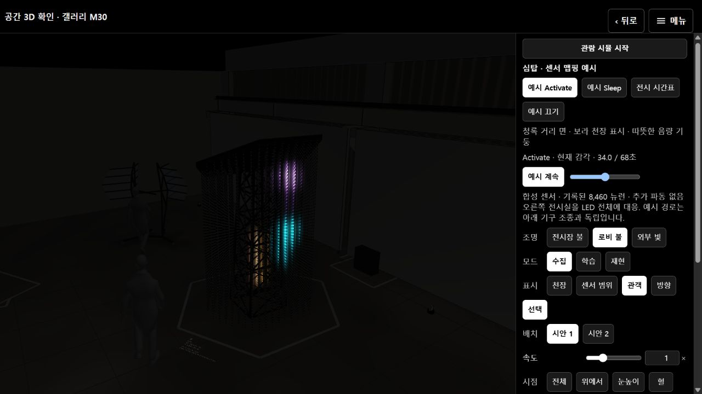
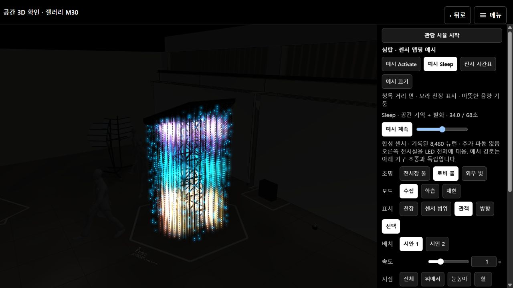

# 감각별 LED 맵핑 — sensory-v2

카메라·천장 거리·소리를 **서로 다른 형태와 높이 구간**으로 읽을 수 있도록 정리했다. 같은 숫자와 같은 위치에는 Activate/Sleep에서 동일한 모양을 쓰며, 두 상태의 차이는 시간 표현이다. 신경망 파라미터는 바꾸지 않는다.

## 무엇을 어떻게 읽는가

| 감각 | 보는 모양 | 값이 달라지면 | 이 표현을 쓰는 이유 |
|---|---|---|---|
| 라이다 카메라 | 중하단의 **청록색 3×3 연결 면** | 멀수록 면이 높아지고, 가까운 영역은 더 밝음 | 9개의 고립된 점보다 주변 거리의 굴곡·연속성이 잘 드러남 |
| 카메라 coverage | 청록 면의 신뢰도 | 유효 화소가 적으면 어두워지고, 없으면 해당 점/연결 없음 | 결측을 가까운 장애물로 잘못 표현하지 않음 |
| 위쪽 라이다 1개 | 혈 XY 상단의 **보라색 짧은 기둥과 가로 표식** | 거리 증가에 따라 상단 표식이 높아짐 | 카메라 면과 높이 구간을 분리하여 한 점 거리임을 구별 |
| 마이크 L/C/R | 맥 XY 주변 **따뜻한 색의 세 음량 기둥** | 소리가 커지면 기둥이 높고 밝아짐, 0이면 꺼짐 | 밝기만으로 읽기 어려운 차이를 길이로도 표현; 채널 정체성 유지 |
| 원시 PCM 선택 입력 | 저/중/고 **세 높이의 색 띠** | 해당 대역 전력이 커지면 밝고 넓어짐 | 주파수는 높이·색, 에너지는 밝기·너비로 분리 |

카메라의 좌·중·우/상·중·하 배열은 **기구 위치에 묶인 센서 구역 표현**이며 세계 좌표상의 점군이 아니다. 위쪽 라이다의 값도 센서에서 천장까지 거리이지 측량된 천장 절대 높이가 아니다. 마이크 3채널은 방향각이나 주파수 3대역으로 바꾸지 않는다.

## 고정 변환과 단위

32×32×24 표시 볼륨에서 z는 0–1의 높이 비율이다. XY는 오른쪽 M30 전시실 전체를 탑 수평면 전체에 대응한다. 아래 변환은 프레임마다 재조정하지 않는다.

| 입력 | sensory-v2 변환 |
|---|---|
| `depth_i` m | `d=clip(depth_i,0,4)`, `u=log(1+d/0.35)/log(1+4/0.35)`, `z=0.12+0.46u` |
| 카메라 밝기 | `sqrt(coverage_i) × (0.40+0.60×(1−d/4))`. 연결선은 양 끝의 작은 밝기 ×0.48 |
| 카메라 배치 | 3×3 구역 간격 1.7 표시 격자. 인접한 유효 구역만 연결; 빠진 구역을 가로질러 잇지 않음 |
| `ceiling_0` m | `z=0.72+0.22×clip(d/4,0,1)`; 줄기는 z=0.64부터, 위에 고정 폭 십자 표식 |
| `mic_level_i` 0–1 | 바닥 z=0.06, 끝점 `z=0.08+0.38×level`, 끝점 세기 `sqrt(level)`; 줄기는 그 0.65배 |
| 마이크 채널 색 | L 호박색 / C 크림색 / R 살구색. 기구 내부 좌우 구분이며 세계 음원 방향은 아님 |
| PCM `band_*` 선형 전력 | 저/중/고 z=0.18/0.46/0.74. `a=clip((10log10(max(power,1e−12))+60)/54,0,1)`, 띠 반폭 `0.5+1.8a`, 세기 a |

카메라의 로그 거리 축은 가까운 영역의 작은 차이를 넓혀 보여 준다. 물리 거리 평균은 여전히 **m 단위**로 계산하며, 화면의 로그값을 평균하지 않는다. 천장 유효 범위는 0<d<60m지만 표시 범위는 4m에서 포화한다. 무효 신호는 표시·누적에서 제외한다.

세 음량 기둥의 `level`은 현재 Pi가 −70..−20dBFS 범위로 정규화한 L/C/R 값이다. 심탑에서 이 숫자를 다시 RMS나 SPL로 변환하지 않는다. PCM을 직접 받는 경우만 DC 제거/FFT/선형 전력 처리 후 주파수 띠를 쓴다.

## Activate / Sleep

- **Activate:** 지금 위치의 감각을 찍고 `exp(−dt/0.9)`로 감쇠한다. 거리 면·천장 표식·음량 기둥이 함께 이동하되 각 특징은 따로 읽힌다.
- **Sleep:** 위치 셀의 원래 특징 평균에 위와 같은 변환을 적용한다. 평균±std가 만든 표상 차이에 1.8초 시간상수의 부드러운 국소 잡음을 곱한다. 거리 변화는 면/표식의 높이 주변에서, 음량 변화는 기둥/띠의 높이·너비·밝기 주변에서 아른거린다.
- std는 **1초 특징 평균들의 표본 표준편차**이며 n<2는 흔들리지 않는다. RGB 공간 보간·상한 때문에 표상이 선형 통계 그래프처럼 읽히는 것은 아니다.
- Sleep의 실제 발화·0.65초 잔광은 별도 층이다. 8,460 뉴런과 gain9.5/0.1ms/40스텝 설정 유지, 추가 방사형 파동 없음.

## 전시장 3D 화면에서 확인

[문래 전시장 3D](http://127.0.0.1:8000/venue3d?test)의 **심탑 · 센서 맵핑 예시**에서:

1. 시점 **심**을 누르면 탑 가까이 볼 수 있다. 전시장 불을 끄면 빛의 구분이 쉬워진다.
2. **예시 Activate / 예시 Sleep**은 같은 재생 시점을 유지하며 화면만 바꾼다.
3. **예시 일시정지**와 시간 슬라이더로 같은 순간을 비교할 수 있다.
4. **전시 시간표**는 한국 시각 11시 기준 20분/10분 상태를 선택한다. 예시 신호 자체는 68초 클립을 반복한다.
5. **예시 끄기**는 기존 수집·학습·재현 효과로 돌아간다.

| Activate — 현재 감각 | Sleep — 공간 기억 + 발화 |
|---|---|
|  |  |

3D 화면은 [M30 예시 GIF](media/m30_active_sleep.gif)와 **동일한 Python 렌더 프레임**을 10Hz로 재생한다. JavaScript에서 비슷한 임의 파동을 새로 만드는 방식이 아니다. 180개 스트립 이름을 맞추어 기존 3D 형상의 길이에 최근접 재표본화하며 첫 구멍 LED는 검정이다. 브라우저에서는 논리 RGB를 사용하고 물리 배선용 R/G 교환·보드 밝기 보정을 중복 적용하지 않는다.

3D의 기구 조종/관객 시뮬레이션과 이 예시 클립의 이동 경로는 독립이다. 이 버튼들은 브라우저의 예시 표시에만 적용되고, 실시간 입력·현장 기억·실물 USB를 바꾸지 않는다. 기존 3D 형상은 실물의 최신 65슬롯 치수를 검증하는 도면을 대신하지 않는다. 이번 연결은 예시 재생이며 live USB 출력의 미러 스트림은 아니다.

[심탑 전체 처리](../src/ripples/README.md) · [네트워크 흐름](DATA_FLOW.md) · [소스](../src/ripples/visualization.py)
