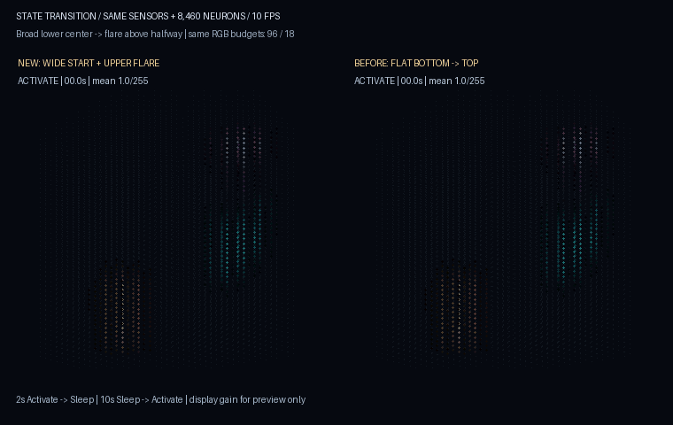
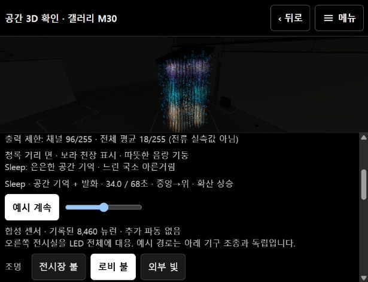
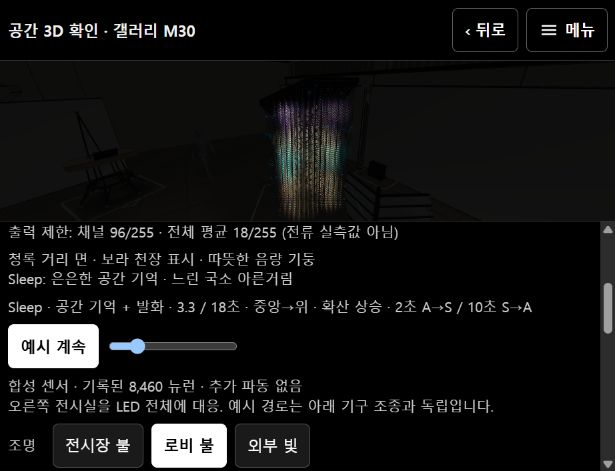

# 중앙에서 위로 퍼지는 전환과 꿈 같은 Sleep

[전시장 3D 예시](http://127.0.0.1:8000/venue3d?test)에서 **중앙에서 위로 확산 / 기존 수평 상승 비교**를 누른다.
18초짜리 같은 센서 구간을 재생하며, **2초에 Activate→Sleep, 10초에 Sleep→Activate**로 바뀐다.
일시정지와 시간 슬라이더로 양쪽의 2.2초(시작), 3.0초(중간), 3.7초(상단) 또는 11.7초(역전환)를 비교할 수 있다. 버튼을 바꾸면 같은 시작점으로 돌아온다.

## 빛의 움직임

- 각 높이에서 0.2초 동안 빠르게 켜지고, 약 0.95초 감쇠 시간으로 잦아든다.
- **아래부터 충분한 폭으로 시작하고, 중간 높이부터 위로 확 벌어진다.** 중앙의 빈 기둥이 아닌 가장 안쪽의 실제 LED부터 시작한다.
- 정규화 높이 h와 중심 거리 r에 대해 시작 시각은 `1.4√h + 0.20r`초다. 같은 높이 간격을 올라가는 시간이 점점 짧아져 상승이 가속된다.
- 시작 반경은 이전 효과의 중간 높이 반경인 `.12 + 1.02×0.5^0.8 ≈ .706`을 사용한다. 반경은 중앙의 빈 기둥 바깥부터 최외곽까지 정규화한 값이다.
- 높이 0–50%에서는 이 폭을 유지한다. 50–85% 구간에서 smoothstep으로 반경1.14까지 빠르게 넓혀 상단 전체에 퍼진다. 가장자리 감쇠 폭 .16 유지.
- 세기는 기존 `.12 + .88h^1.4` 그대로여서 아래는 약하고 위로 갈수록 밝다. 픽셀/전체 출력 상한도 그대로다.
- 약 1.6초에 상단 가장자리까지 도달한다. 아래의 바깥쪽 전체를 평면으로 켜는 효과가 아니라 위로 벌어지는 형태다.
- 기존 화면에서 새 상태로 2.6초 동안 부드럽게 섞이고, 전환 시작 후 5초에는 추가 빛이 완전히 사라진다.
- 옅은 금빛 전환광은 상태가 바뀔 때만 발생한다. 같은 상태를 매 프레임 설정해도 재시작하지 않는다.
- 전환 도중 다시 바뀌면 현재 출력에서 새 전환을 시작한다. 중첩해 밝기를 더하지 않는다.
- 프로그램을 켤 때는 전환광이 없다. 11시 기준 20분 Activate / 10분 Sleep 시간표는 그대로이며, 실제 상태 변경 시 한 번 실행된다.

이것은 상태 경계를 알리는 표시 효과다. 8,460 뉴런, gain9.5와 criticality 계산은 바꾸지 않는다.
평상시 Sleep에는 추가 방사형 파동이 없으며, 기존 발화와 평균·std의 아른거림을 표시한다.

## Sleep의 은은한 공간 기억 — dream-v2

- 위치별 평균으로 만든 센서 표상은 **기본 밝기 72%**로 부드럽게 낮춘다. 특징의 위치·높이·색 의미는 Activate와 같다.
- 관측 2회 이상에서 구한 **std만** 국소적인 아른거림의 크기에 반영한다. std=0 또는 관측 1회는 임의로 흔들리지 않는다.
- 시간상수는 1.8초에서 **3.2초**, 공간 평활화 sigma는 .75에서 **1.1 표시 셀**로 바꿨다. 강도 기본값 .45 유지.
- 각 위치에서 밝기가 천천히 흐려지고 되살아나는 효과이며, 새 이동 흔적이나 주기적인 전체 파동을 만들지 않는다.
- 기존 criticality의 발화·0.65초 잔광은 별도 층으로 유지한다. 저장된 mean/std 자체는 바꾸지 않는다.

`ripples.live`와 `ripples.run`은 같은 `RipplesVisual`을 사용한다. 기록된 예시 모드의 Sleep RGB 클립도 이 새 렌더러로
680프레임을 다시 만들었으며, `sleep_style=dream-v2` 메타데이터와 SHA256으로 이전 클립과 혼용되지 않게 확인한다.
실제 출력 코드와 3D가 모두 같은 기억 표현·전환식·출력 예산을 따른다. 3D 형상은 실물 스트립 길이에 대한 근사다.

## 밝기 제어

센서·발화 원본의 RGB를 **96/255로 선형 축소**한 뒤 전환광과 합성한다. 원본의 발화 감쇠와 색 비율을 유지하기 위한 방법이다.
마지막 단계에서 각 채널 **96/255 이하**, 가시 LED 전체의 RGB 평균 **18/255 이하**로 제한한다.
이 제한은 전환 중뿐 아니라 평상시에도 적용되어 전환 끝에서 갑자기 밝아지지 않는다.
전체 평균 제한은 RGB 비율을 유지한 채 프레임 전체를 낮춘다.

Python 출력은 실제 `InstallationEncoder`의 최근접 배치에서 각 모델 픽셀이 몇 번 쓰이는지 세어
**10,260개 가시 LED에 대한 정확한 가중 평균**을 계산한다. 구멍 LED와 패딩은 계속 검정이다.
브라우저는 기존 3D 형상의 스트립을 실물 길이로 가중한 화면용 근사이며 동일한 합성식을 사용한다.
RGB565 보드의 기존 밝기 32 설정은 올리지 않는다. 표시 제한은 RGB565 양자화/보드 밝기 처리 전 논리 RGB 기준이다.

**18/255는 전류(A)나 전력(W)의 측정값이 아니다.** 전원·분기 배선의 허용 전류와 온도는 이번 작업에서 확인하지 않았다.
따라서 이 수치를 실물의 발열 안전 보장으로 해석할 수 없다. 이번 검증은 파일과 브라우저 예시이며 USB로 송신하지 않았다.
GIF는 작은 점을 알아보기 쉽게 표시 감마를 적용하므로 실제 밝기 측정 자료가 아니다.

## 구현과 적용 범위

- `src/ripples/transition.py`: 양방향 높이 지연·감쇠·화면 혼합·출력 제한.
- `RipplesVisual`: 상태가 바뀔 때 실행. live/run 기본 `up`은 새 중앙 확산 상승이다. `up_flat`은 이전 수평 상승, `down`은 이전 하강 비교용이다.
- 기존 센서 수신·기억·스케줄 계산은 계속 진행된다. 전환은 마지막 표시 단계에만 적용한다.
- 예시 Activate/Sleep 버튼과 전시 시간표에도 같은 전환을 적용한다. 비교에서 선택한 방향을 사용한다.
- `ripples.transition_example`: 저장된 동일 M30 센서/발화 구간으로 10 FPS 비교 GIF를 다시 만든다.
- 저장된 68초 RGB 클립은 원본 표시 신호이고, 브라우저에서 새 출력 제한과 전환을 적용한다.
  M30 GIF도 새 Sleep 표현으로 다시 생성했으며, 출력 제한 이전의 논리 신호를 보여준다. 실제 출력 제한과 전환은 위의 새 GIF가 기준이다.
- 실시간 USB 프로세스를 새로 시작하거나 송신하지 않았다. 다음 실행부터 업데이트된 렌더러가 사용된다.

## 실제 3D 화면

[감각별 맵핑](SENSOR_MAPPING.md) · [검증 기록](validation.md)

이전 [평면 상승/하강 GIF](media/state_transition_compare.gif)는 과거 비교 자료로 보존한다.

기본 [3D 위치 연동](VENUE_POSITION_LINK.md)은 현재 기구 위치에서 브라우저가 감각 표상과 임시 기억을 만들며, 같은 전환·출력 상한을 적용한다.
