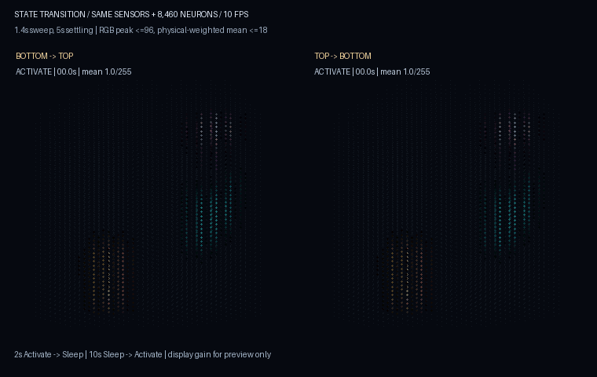
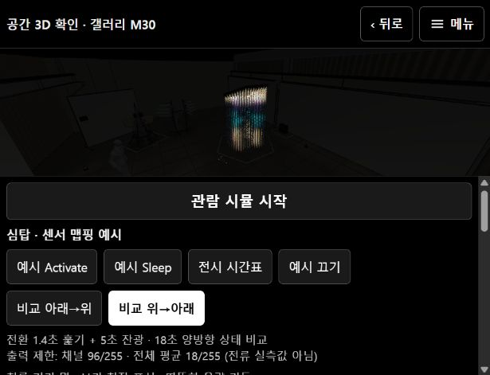

# Activate ↔ Sleep 전환 비교

[전시장 3D 예시](http://127.0.0.1:8000/venue3d?test)에서 **비교 아래→위 / 비교 위→아래**를 누른다.
18초짜리 같은 센서 구간을 재생하며, **2초에 Activate→Sleep, 10초에 Sleep→Activate**로 바뀐다.
일시정지와 시간 슬라이더로 양쪽의 2.4초 또는 10.4초를 비교할 수 있다. 버튼을 바꾸면 같은 시작점으로 돌아온다.

## 빛의 움직임

- 각 높이에서 0.2초 동안 빠르게 켜지고, 약 0.95초 감쇠 시간으로 잦아든다.
- 높이별 시작 시간을 벌려 **1.4초 동안 아래→위 또는 위→아래로 훑는다**. 순차적으로 탑 전체에 도달한다.
- 기존 화면에서 새 상태로 2.6초 동안 부드럽게 섞이고, 전환 시작 후 5초에는 추가 빛이 완전히 사라진다.
- 옅은 금빛 전환광은 상태가 바뀔 때만 발생한다. 같은 상태를 매 프레임 설정해도 재시작하지 않는다.
- 전환 도중 다시 바뀌면 현재 출력에서 새 전환을 시작한다. 중첩해 밝기를 더하지 않는다.
- 프로그램을 켤 때는 전환광이 없다. 11시 기준 20분 Activate / 10분 Sleep 시간표는 그대로이며, 실제 상태 변경 시 한 번 실행된다.

이것은 상태 경계를 알리는 표시 효과다. 8,460 뉴런, gain9.5와 criticality 계산은 바꾸지 않는다.
평상시 Sleep에는 추가 방사형 파동이 없으며, 기존 발화와 평균·std의 아른거림을 표시한다.

## 밝기 제어

센서·발화 원본의 RGB를 **96/255로 선형 축소**한 뒤 전환광과 합성한다. 원본의 발화 감쇠와 색 비율을 유지하기 위한 방법이다.
마지막 단계에서 각 채널 **96/255 이하**, 가시 LED 전체의 RGB 평균 **18/255 이하**로 제한한다.
이 제한은 전환 중뿐 아니라 평상시에도 적용되어 전환 끝에서 갑자기 밝아지지 않는다.
전체 평균 제한은 RGB 비율을 유지한 채 프레임 전체를 낮춘다.

Python 출력은 실제 `InstallationEncoder`의 최근접 배치에서 각 모델 픽셀이 몇 번 쓰이는지 세어
**10,260개 가시 LED에 대한 정확한 가중 평균**을 계산한다. 구멍 LED와 패딩은 계속 검정이다.
브라우저는 기존 3D 형상의 스트립을 실물 길이로 가중한 화면용 근사이며 동일한 합성식을 사용한다.
RGB565 보드의 기존 밝기 32 설정은 올리지 않는다. 표시 제한은 RGB565 양자화/보드 밝기 처리 전 논리 RGB 기준이다.

**18/255는 전류(A)나 전력(W)의 측정값이 아니다.** 전원·분기 배선의 허용 전류와 온도는 이번 작업에서 확인하지 않았다.
따라서 이 수치를 실물의 발열 안전 보장으로 해석할 수 없다. 이번 검증은 파일과 브라우저 예시이며 USB로 송신하지 않았다.
GIF는 작은 점을 알아보기 쉽게 표시 감마를 적용하므로 실제 밝기 측정 자료가 아니다.

## 구현과 적용 범위

- `src/ripples/transition.py`: 양방향 높이 지연·감쇠·화면 혼합·출력 제한.
- `RipplesVisual`: 상태가 바뀔 때 실행. live/run 기본 방향은 아래→위; `--transition-direction down`으로 반대 방향 선택.
- 기존 센서 수신·기억·스케줄 계산은 계속 진행된다. 전환은 마지막 표시 단계에만 적용한다.
- 예시 Activate/Sleep 버튼과 전시 시간표에도 같은 전환을 적용한다. 비교에서 선택한 방향을 사용한다.
- `ripples.transition_example`: 저장된 동일 M30 센서/발화 구간으로 10 FPS 비교 GIF를 다시 만든다.
- 저장된 68초 RGB 클립은 원본 표시 신호이고, 브라우저에서 새 출력 제한과 전환을 적용한다.
  원본 M30 GIF는 이전 표시 밝기를 보여주는 자료이며, 현재 전환/밝기는 이 페이지의 새 GIF가 기준이다.
- 실시간 USB 프로세스를 새로 시작하거나 송신하지 않았다. 다음 실행부터 업데이트된 렌더러가 사용된다.

## 실제 3D 화면

[감각별 맵핑](SENSOR_MAPPING.md) · [검증 기록](validation.md)
