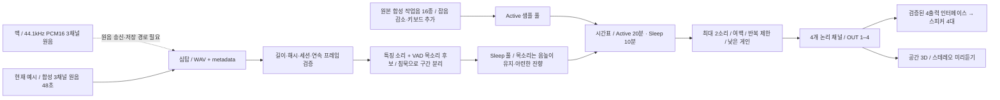
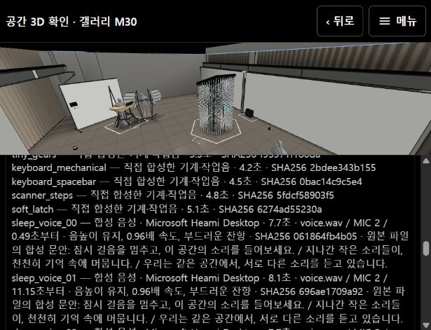

# 심탑의 네 소리 출력

심탑은 **수집할 때 일하는 소리**, **잠들 때 맥이 들었던 소리의 변형**을 냅니다. 네 스피커는 독립 출력이지만, 동시에 울리는 주요 소리는 탑 전체에서 최대 두 개입니다. 잔향도 소리의 길이에 포함합니다. 빈 시간을 두고 다른 출력이 대답하게 해 밀도를 낮춥니다.

현재 제공한 Sleep은 **합성한 맥 3채널 녹음으로 만든 예시**입니다. 실제 현장 녹음을 확보했다는 뜻이 아닙니다. 기존 맥 LAN 송신은 음량 요약 `mics/rms`이며, 그 숫자로 원래 소리를 복원할 수 없습니다.

## 소리가 흐르는 경로



센서 수신과 LED용 mean/std 누적은 오디오 상태와 독립적입니다. 8,460개 뉴런, criticality 파라미터, LED 전환과 은은한 Sleep 표상은 유지했습니다. 이번 소리는 criticality의 발화를 합성한 것이 아니며, LED와 **상태 시간표**를 공유합니다.

## Active — 20분

| 소리 계열 | 의도 |
|---|---|
| 서보·작은 회전·기어 | 감각기구가 몸을 움직이고 준비하는 느낌 |
| 부드러운 릴레이·메모리 키 | 작업이 짧게 시작하고 끝나는 느낌 |
| 계산·텔레메트리 | 공간을 읽고 처리하는 신호 |
| 공기 밸브·액체 회로·대사 맥동 | 기계와 생물 사이의 호흡 |
| 키보드 타건·스페이스바·스캐너 단계·걸쇠 | 잡음보다 동작과 리듬이 들리는 작업 |

외부 음원 없이 코드로 만든 16종, 각각 약 3.3–5.6초입니다. 공기 계열의 연속 잡음 성분은 합성 단계의 진폭을 0.12→0.015로 줄이고, 서보·릴레이의 마찰음도 낮췄습니다. 작은 잡음을 완전히 없애지는 않았습니다. 소리 시작과 끝은 부드럽게 감쇠합니다. 대부분 한 소리가 끝난 뒤 1.3–4.8초 쉬고, 약 30%의 선택에서 다음 소리가 앞 소리의 뒤쪽과 조금 겹칩니다. 같은 샘플은 16초 이내 재선택하지 않습니다. 스피커 사용 횟수가 비슷하도록 배분합니다.

예시 파일은 고정 난수 시드로 재현할 수 있는 190개 이벤트입니다. 실제 Python 플레이어는 각 시간표 구간에서 새 조합을 만듭니다. 브라우저와 다운로드 예시는 비교를 위해 고정 조합을 사용합니다.

## Sleep — 10분

1. `device_id + session_id + start_frame` 순서로 원음을 읽습니다. 같은 장치·세션·샘플레이트·채널 수이며 프레임이 이어질 때만 묶습니다. 결측 구간과 다른 세션을 이어 붙이지 않습니다. 메타데이터 없는 WAV는 독립 파일로 처리합니다.
2. 최대 24초씩 읽고, 기본 총 입력 한도는 1,800초입니다. 무음과 심한 클리핑을 제외합니다. 0.5초 간격 후보의 약 3.2초 구간을 에너지 대비, 음량 변화, 스펙트럼 질감으로 평가합니다. **소리의 의미를 분류하는 AI는 아닙니다.** 겹치는 후보를 억제해 최대 12개를 선택합니다.
3. 구간마다 가장 잘 들리는 마이크 하나를 선택합니다. 3채널을 무조건 더해 위상 상쇄를 만들지 않습니다. 선택된 채널, 원본 프레임, 파일, 세션, 점수는 manifest에 남깁니다.
4. **환경음**은 0.72/0.82/0.90배 속도로 길이와 음높이를 함께 낮추고 작은 잔향을 더합니다. **목소리 후보**는 별도 WebRTC VAD로 찾아 침묵 간격 0.55초 이내를 묶고 앞뒤 문맥을 남깁니다. 보통 한 발화 단위를 유지하되 14초를 넘으면 10–14초 사이 조용한 지점에서 나눕니다. 파일/처리 경계에서 잘린 후보는 `boundary_cut`에 표시합니다. 문장 의미·마침표·화자를 인식하는 ASR은 아닙니다. VAD에는 오검출·누락이 있을 수 있습니다.
5. 목소리는 **음높이를 유지하며 0.96배 속도**, 직접음 뒤 65ms부터 낮고 부드러운 2.4초 잔향을 붙입니다. 잔향 비중은 0.22, 역재생·급격한 변조·음성 복제는 없습니다. 마른 목소리가 앞에서 들리고 잔향이 뒤를 받쳐 아련하고 경건한 분위기를 목표로 합니다.
6. 탑 전체 최대 두 소리를 유지하되 **목소리는 동시에 하나**, 다음 목소리까지 잔향 종료 후 최소 6초, 같은 목소리 샘플 재선택은 45초 이후입니다. 환경음은 함께 들릴 수 있습니다. 현재 10분 예시는 82개 이벤트입니다.

선택 방식은 녹음의 질감과 목소리 후보에 반응합니다. 예시 목소리는 **Microsoft Windows SAPI / Microsoft Heami Desktop**으로 이 프로젝트 문안을 합성한 것이며 실제 관객 녹음이 아닙니다. [샘플별 출처·원본·구간·효과](../data_led_example/tower_audio/SOURCES.md)를 확인할 수 있습니다. 3D의 **소리 출처와 처리 내역**에서도 같은 구분을 표시합니다.

## 상태·시간·음량

- 한국 시각 11:00을 기준으로 `:00–:20` Active, `:20–:30` Sleep, 다음 30분 주기를 반복합니다. 늦게 시작해도 해당 구간의 현재 위치에서 재생합니다. 영업 종료 자동 정지는 기존 시간표처럼 별도 설정입니다.
- 실제 플레이어는 기존 `ExhibitionSchedule`을 사용합니다. 구간 끝 약 0.7초에 감쇠하고 다음 구간은 부드럽게 시작합니다. 교체 때 네 소리를 동시에 겹치는 크로스페이드는 하지 않습니다.
- 기본 디지털 master **0.22**, 조절 상한 **0.30**, 최종 절대 샘플 피크 상한 **0.16**. 실제 예시의 채널별 최대치는 약 **0.093 (−20.6dBFS)**입니다. OS·앰프 볼륨은 변경하지 않습니다. 이 숫자는 실제 공간의 음압 dB SPL이 아닙니다.
- 스피커 번호는 논리 OUT 1–4입니다. 설치 방위가 정해지지 않아 전후좌우를 임의로 확정하지 않았습니다. 현재는 균등 분배이며 맥 위치를 따라 소리가 이동하는 공간 음향은 아닙니다.

## 공간 3D에서 비교

[공간 3D](http://127.0.0.1:8000/venue3d?test)의 **심탑 · 4출력 소리 → 소리 시작**을 누릅니다. 자동 재생하지 않습니다.

위의 **예시 Activate / 예시 Sleep / 전시 시간표** 선택을 그대로 따릅니다. 출력 네 개의 현재 샘플과 쉼을 표시하고, 예시 일시정지와 끄기도 따릅니다. 소리 슬라이더로 20분/10분 중간을 들어볼 수 있습니다. 전시 시간표에서는 시각이 기준이므로 소리 탐색을 비활성화합니다. 전환 비교의 빠른 상태 변화도 따라가지만, 실제 전시 구간은 20분/10분입니다.

브라우저는 네 논리 출력을 **2채널로 내려 섞어 미리듣습니다**. 왼쪽/오른쪽 차이는 비교용이며 실제 네 스피커가 연결됐다는 뜻이 아닙니다. 웹판 내려받기에도 소리 뱅크와 플레이어를 포함합니다.



화면 캡처는 낮은 시험 음량 10%에서 상태 전환을 확인한 모습입니다. 기본값은 22%이며 검증 후 재생을 정지했습니다.

## 실제 장치와 녹음 연결

[출력 설정](../configs/audio.m30.json)의 `device`는 아직 `null`입니다. 현재 세션에서는 PortAudio 출력 장치가 열거되지 않아 실출력은 시작하지 않았습니다. `channel_map: [0,1,2,3]`은 0부터 세는 물리 채널 네 개에 논리 OUT 1–4를 대응시킵니다. **단자가 네 개라는 사실과 독립 출력 채널이 네 개라는 사실은 다릅니다.** 우선 한 인터페이스의 4개 이상 출력을 지원하며, 서로 다른 USB/잭 장치 네 대를 자동으로 묶는 기능은 없습니다.

플레이어는 장치를 명시하고 채널 수·설정한 샘플레이트의 float32 출력을 검사한 뒤에만 엽니다. 기본 장치 출력은 48kHz이며, 24kHz 뱅크를 콜백 밖에서 미리 리샘플링합니다. 24/44.1/48kHz를 설정할 수 있습니다. 스테레오나 HDMI로 임의 대체하지 않습니다. 지원하지 않는 샘플레이트이면 시작 전에 실패합니다. 합성 Sleep을 실제 장치에서 시험하려면 `--allow-demo`를 명시합니다.

```text
ripples-audio --list-devices
ripples-audio --device <확인한 장치 ID> --allow-demo
```

실제 WAV 폴더가 준비되면 별도의 완성 뱅크를 먼저 생성합니다. 원음 데이터 폼은 [맥 WAV 규격](../data_led_example/sensors/protocols/sound.md)을 따릅니다. `audio.wav + metadata.json`, 또는 `<name>.wav + <name>.json`을 인식합니다. 현재 음량 요약 HTTP 입력에 WAV 송신 기능을 자동 추가한 것은 아닙니다.

```text
ripples-audio-build --recordings <맥 WAV 폴더> --bank runtime/audio-next --output runtime/audio-review --bank-only
ripples-audio --bank runtime/audio-next --device <확인한 장치 ID>
```

실제 원음·추출본은 `runtime/`에 두어 Git에 자동 포함하지 않습니다. 연속 수집에는 아래의 용량 제한 Sound Space를 사용합니다. 완성 뱅크 세대를 만든 뒤 CURRENT.json을 원자적으로 바꾸며, `ripples-audio --bank runtime/sound-space --device <ID>`는 상태 경계에서 현재 뱅크를 다시 읽습니다. 오디오 콜백에서는 파일·네트워크 I/O를 하지 않습니다. 브라우저 예시는 검토한 뱅크를 배포하고 새로고침해야 바뀝니다.

## 용량과 검증

44.1kHz PCM16 3채널 원음은 약 **0.953GB/시간**, 24시간이면 **22.86GB/일**입니다. [Sound Space 용량 정책](../configs/sound-space.m30.json)을 가진 전용 수신·보관 코드를 추가했습니다.

| 구분 | 제한 |
|---|---|
| 임시 원음 FLAC | 최대 512MiB / 최근 1시간 / 최대 2,048조각 중 먼저 도달하는 한도 |
| 선별 소리 풀 FLAC | 최대 256MiB / 최근 관측부터 30일 / 최대 512개 |
| 재생 뱅크 | 최근 선별 소리 최대 32개, 완성된 현재·직전 세대 합계 최대 64MiB |
| 관리 DB | 약 32MiB 상한, SQLite journal 보관 한도 1MiB |
| 디스크 여유 | 2GiB 미만이 될 입력·뱅크는 거절하고 상태에 오류 표시 |
| 한 업로드 | WAV 최대 1MiB, 44.1kHz PCM16 3ch, 1초 이하 |

용량·기간이 초과하면 **이 프로그램이 만든 전용 폴더의 오래된 항목만** 정리합니다. 기존 녹음 폴더의 원본은 지우지 않습니다. 정확한 중복 및 유사한 스펙트럼·길이의 샘플을 억제하며, 유사도 필터는 같은 문장을 의미적으로 식별하는 기능은 아닙니다. 처리 중인 원음은 잠시 보호하고, 용량 때문에 처리 전 원음이 탈락하면 `unprocessed_evicted`로 보고합니다. 미완성 파일도 실제 사용 용량에 포함합니다. 오래된 재생 세대는 처리 중 읽기를 위한 짧은 유예 후 정리합니다.

선별·정리는 두 상태 모두 계속되며, Sleep 진입 시 완성된 뱅크를 읽습니다. 수신기가 실행 중일 때 5초 간격으로 처리·정리합니다. 센서의 기존 HTTP 음량 요약과 LED 누적 설정은 바꾸지 않습니다.

```text
ripples-sound-space serve --root runtime/sound-space --bind <심탑 LAN IP> --port 9503
ripples-sound-space status --root runtime/sound-space
```

새 수신 주소는 `http://<심탑 LAN IP>:9503/audio`, 상태는 `/status`입니다. `Content-Type: audio/wav`, `X-Audio-Metadata` JSON, `Idempotency-Key: chunk_id`와 WAV body를 받습니다. 장치·세션·프레임·원본 SHA256을 검사하고 저장이 끝난 뒤 ACK합니다. 용량 부족은 507, 잘못된 입력은 400입니다. 이 경로는 로컬 HTTP 시험을 통과했으며 **실제 맥 Pi의 원음 송신은 아직 연결하지 않았습니다**. 지금 켜진 8000번 전시 서버에 새 녹음 수신을 자동 시작하지 않았습니다.

완성 예시는 24kHz PCM16 **4채널 FLAC**(Active 약 10.5MB, Sleep 약 3.8MB), **스테레오 MP3**(14.4MB, 7.2MB), 90초 발췌, 28개 모노 WAV 뱅크입니다. 4채널 FLAC을 일반 음악 앱에서 재생하면 자동으로 스테레오로 섞일 수 있으므로 실제 배선 검증은 명시적 채널 맵을 가진 플레이어에서 합니다.

[음원·전체 길이·타임라인](../data_led_example/tower_audio/README.md) · [검증 수치](../data_led_example/tower_audio/validation.json) · [코드](../src/ripples/tower_audio.py)

장치 검사는 [sounddevice 공식 문서](https://python-sounddevice.readthedocs.io/en/latest/api/checking-hardware.html), 브라우저 채널 수는 [AudioDestinationNode 공식 API 문서](https://developer.mozilla.org/en-US/docs/Web/API/AudioDestinationNode/maxChannelCount)를 기준으로 분리했습니다.
