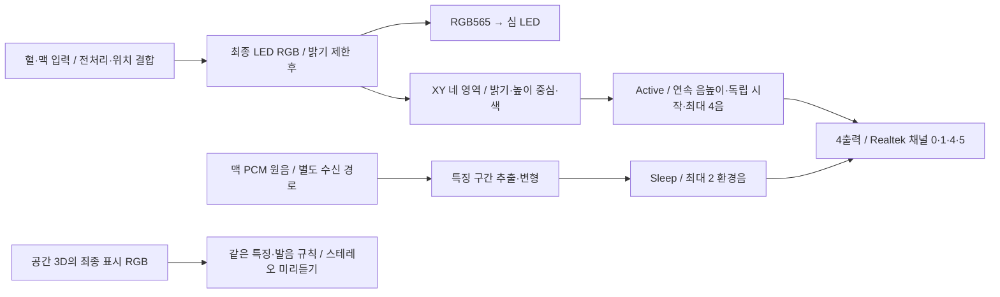
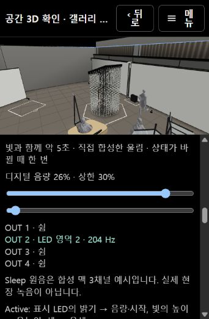
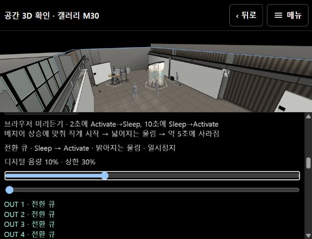
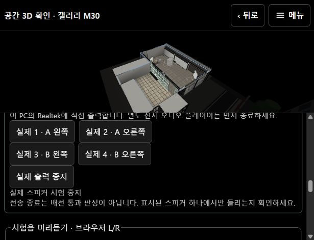
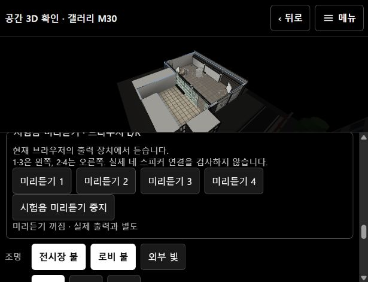

# 심탑의 네 소리 출력

Active는 **심에 실제 표시되는 LED 값**에서 최대 네 음을 만듭니다. Sleep은 맥 원음의 특징 구간을 변형해 최대 두 소리로 재생합니다. 두 상태의 전환 큐와 20분/10분 시간표는 유지합니다. Sleep의 현재 예시는 합성 맥 녹음이며 현장 실녹음이 아닙니다.

## 소리가 흐르는 경로



## Active — 표시 데이터로 만드는 20분

| 표시 값 | 소리 규칙 |
|---|---|
| XY 네 영역 | OUT 1–4 각각 한 음, 총 최대 네 음 |
| 영역 밝기 상승 | 이전 프레임보다 level이 0.018 이상 오르면 가능한 즉시 발음 |
| 지속되는 빛 | 밝기 적분이 0.22에 도달하면 재발음; 어두우면 침묵 |
| 밝기 가중 높이 중심 h | 연속 주파수 `120 × 2^(2h + 0.6w)` Hz; 음계에 맞추지 않음 |
| 정규화 밝기 L | 원음 gain `0.10 + 0.14L`; master를 별도로 곱함 |
| 적색 비율 w | 약한 비정수 주파수 성분의 비율 `1.31 + 0.43w` |
| 높이 h | 길이 `1.05 + 1.65h`초; sin² 포락선으로 부드럽게 시작·종료 |

최종 RGB를 96으로 나누어 0–1로 제한합니다. L은 실제 LED 수로 가중한 평균 RGB 밝기의 제곱근입니다. h는 같은 밝기로 가중한 0–1 높이 중심, w는 적색 에너지/전체 RGB 에너지입니다. 각 영역은 기존 음이 끝난 뒤 0.15초 쉬며 다시 발음할 수 있습니다. 공간 경계는 정규화 X·Y의 0.5이며 OUT 인덱스는 `1 + (X≥0.5) + 2×(Y≥0.5)`입니다. 물리적 스피커 방향은 현장 배선 후 확인합니다.

함께 밝아지는 영역은 같은 프레임에 시작하고, 따로 밝아지면 엇갈립니다. 무작위 음 선택·고정 코드 진행은 없습니다. 8,460개 뉴런과 criticality 설정은 바꾸지 않습니다. Active의 센서 흔적이 소리 입력이며, 이 소리를 원래 마이크 녹음의 복원이라고 해석하지 않습니다.

Python `live.py` / `run.py`는 최종 LED 렌더 뒤에 `runtime/led-sonification.json`을 원자적으로 교체합니다. 파일은 최신 한 프레임뿐이고 DB나 소리 이력은 쌓지 않습니다. `audio_play.py`는 오디오 콜백 밖에서 10Hz로 읽으며 1.5초 이상 오래됐거나 유효하지 않은 입력은 약 0.18초에 걸쳐 무음으로 만듭니다. 정상 입력은 `{schema:"ripples.led-sound.v1", timestamp, version, state, source:"final_led_frame", regions:[{level,height,warmth}, ...4개]}`입니다. LED 프로세스와 오디오 프로세스는 같은 상태 시간표를 사용해야 하며 일치하는 Activate 입력이 없으면 임의 샘플을 대신 틀지 않습니다.

두 오디오 설정의 `active_source`는 `led`입니다. `led_frame_file:null`은 위 기본 경로를 뜻합니다. Realtek master 0.16, 브라우저 0.26과 상한 0.30을 유지합니다. 브라우저는 현재 표시된 RGB에서 직접 추출하며 네 논리 출력을 스테레오로 섞습니다. 실제 독립 출력 검증은 별도의 스피커 테스트 버튼을 사용합니다. 전환 큐 5초 동안에는 일반 데이터 음을 시작하지 않습니다.

[60초 새 소리](../data_led_example/tower_audio/led_sonification/led_60s_stereo.wav)는 저장된 합성 센서 LED 예시의 첫 60초를 사용합니다. [출처·입력 SHA256·프레임 특징·발음 기록](../data_led_example/tower_audio/led_sonification/provenance.json), [재생성 코드](../scripts/render_led_sound.py)를 함께 제공합니다. 69개 음, 동시 시작 4묶음과 단독 시작 61회, 스테레오 디지털 피크 약 0.0404입니다. 볼륨 수치는 실제 음압 측정치가 아닙니다.

이전 `dream-work-v3` 작업음 뱅크와 20분 파일은 **보관된 비교 예시**입니다. 현재 기본 Active에서는 재생하지 않으며, `active_source:bank`를 명시하면 이전 방식으로 돌아갈 수 있습니다. 아래 샘플 풀·계획 문서는 Sleep 및 이전 작업음 자료에 해당합니다.



## Sleep — 10분

**현재 재생에서는 말소리 후보를 제외**합니다. 아래 VAD·목소리 처리 기능과 이전 예시 원본은 보관하지만, 실제 플레이어·브라우저·새 10분 파일은 환경음만 사용합니다. 실녹음의 VAD는 완벽한 음성 제거기가 아니므로, 미검출된 말소리는 현장 음원 검수도 필요합니다.

1. `device_id + session_id + start_frame` 순서로 원음을 읽습니다. 같은 장치·세션·샘플레이트·채널 수이며 프레임이 이어질 때만 묶습니다. 결측 구간과 다른 세션을 이어 붙이지 않습니다. 메타데이터 없는 WAV는 독립 파일로 처리합니다.
2. 최대 24초씩 읽고, 기본 총 입력 한도는 1,800초입니다. 무음과 심한 클리핑을 제외합니다. 0.5초 간격 후보의 약 3.2초 구간을 에너지 대비, 음량 변화, 스펙트럼 질감으로 평가합니다. **소리의 의미를 분류하는 AI는 아닙니다.** 겹치는 후보를 억제해 최대 12개를 선택합니다.
3. 구간마다 가장 잘 들리는 마이크 하나를 선택합니다. 3채널을 무조건 더해 위상 상쇄를 만들지 않습니다. 선택된 채널, 원본 프레임, 파일, 세션, 점수는 manifest에 남깁니다.
4. **환경음**은 0.72/0.82/0.90배 속도로 길이와 음높이를 함께 낮추고 작은 잔향을 더합니다. **목소리 후보**는 별도 WebRTC VAD로 찾아 침묵 간격 0.55초 이내를 묶고 앞뒤 문맥을 남깁니다. 보통 한 발화 단위를 유지하되 14초를 넘으면 10–14초 사이 조용한 지점에서 나눕니다. 파일/처리 경계에서 잘린 후보는 `boundary_cut`에 표시합니다. 문장 의미·마침표·화자를 인식하는 ASR은 아닙니다. VAD에는 오검출·누락이 있을 수 있습니다.
5. 목소리는 **음높이를 유지하며 0.96배 속도**, 직접음 뒤 65ms부터 낮고 부드러운 2.4초 잔향을 붙입니다. 잔향 비중은 0.22, 역재생·급격한 변조·음성 복제는 없습니다. 마른 목소리가 앞에서 들리고 잔향이 뒤를 받쳐 아련하고 경건한 분위기를 목표로 합니다.
6. 현재 재생은 목소리 후보를 걸러낸 환경음만 사용하며 탑 전체 최대 두 소리를 유지합니다. 이전의 음성 실험 기능을 명시적으로 호출할 때만 목소리 하나·6초 간격 제한을 적용합니다. 현재 10분 예시는 82개 이벤트입니다.

선택 방식은 녹음의 질감과 목소리 후보에 반응합니다. 예시 목소리는 **Microsoft Windows SAPI / Microsoft Heami Desktop**으로 이 프로젝트 문안을 합성한 것이며 실제 관객 녹음이 아닙니다. [샘플별 출처·원본·구간·효과](../data_led_example/tower_audio/SOURCES.md)를 확인할 수 있습니다. 3D의 **소리 출처와 처리 내역**에서도 같은 구분을 표시합니다.

## 상태·시간·음량

- 한국 시각 11:00을 기준으로 `:00–:20` Active, `:20–:30` Sleep, 다음 30분 주기를 반복합니다. 늦게 시작해도 해당 구간의 현재 위치에서 재생합니다. 영업 종료 자동 정지는 기존 시간표처럼 별도 설정입니다.
- 실제 플레이어는 기존 `ExhibitionSchedule`을 사용합니다. 구간 끝 약 0.7초에 감쇠하고 다음 구간은 부드럽게 시작합니다. 교체 때 네 소리를 동시에 겹치는 크로스페이드는 하지 않습니다.
- 브라우저·파일의 기본 디지털 master **0.26**, Realtek 초기값 **0.16**, 조절 상한 **0.30**, 최종 절대 샘플 피크 상한 **0.16**. 실제 예시의 채널별 최대치는 약 **0.110 (−19.2dBFS)**입니다. OS·앰프 볼륨은 변경하지 않습니다. 이 숫자는 실제 공간의 음압 dB SPL이 아닙니다.
- 스피커 번호는 논리 OUT 1–4입니다. 설치 방위가 정해지지 않아 전후좌우를 임의로 확정하지 않았습니다. 현재는 균등 분배이며 맥 위치를 따라 소리가 이동하는 공간 음향은 아닙니다.

## 공간 3D에서 비교

[공간 3D](http://127.0.0.1:8000/venue3d?test)의 **심탑 · 소리 미리듣기 → 미리듣기 시작**을 누릅니다. 자동 재생하지 않습니다.

위의 **예시 Activate / 예시 Sleep / 전시 시간표** 선택을 그대로 따릅니다. 출력 네 개의 현재 샘플과 쉼을 표시하고, 예시 일시정지와 끄기도 따릅니다. 소리 슬라이더로 20분/10분 중간을 들어볼 수 있습니다. 전시 시간표에서는 시각이 기준이므로 소리 탐색을 비활성화합니다. 전환 비교의 빠른 상태 변화도 따라가지만, 실제 전시 구간은 20분/10분입니다.

브라우저는 네 논리 출력을 **2채널로 내려 섞어 미리듣습니다**. 왼쪽/오른쪽 차이는 비교용이며 실제 네 스피커가 연결됐다는 뜻이 아닙니다. 웹판 내려받기에도 소리 뱅크와 플레이어를 포함합니다.


화면 캡처는 낮은 시험 음량 10%에서 상태 전환을 확인한 모습입니다. 현재 기본값은 26%이며 검증 후 재생을 정지했습니다.

## 실제 장치와 녹음 연결

### Activate ↔ Sleep 전환 큐

양방향 LED 상태 전환의 **상승 진행률·밝기 fade-in·새 상태 혼합**은 `cubic-bezier(0.42, 0, 1, 1)` ease-in을 사용합니다. 초반에 천천히 시작하고 위로 갈수록 가속합니다. 총 5초, 상승 1.4초, 넓은 중앙부 시작·중간 높이 이후 확산은 유지하며, 사라지는 잔광은 기존의 부드러운 감쇠를 유지합니다. Python의 실제 LED와 브라우저 3D가 같은 곡선을 쓰고, 큐도 이 곡선으로 재생성합니다. 8,460개 뉴런·criticality 및 RGB 밝기 제한은 바꾸지 않았습니다.



기존 중앙 아래에서 위로 퍼지는 LED의 `pulse_field`를 따라 **약 5초짜리 울림**을 넣었습니다. 처음에는 작게 시작하고, 빛이 중간 높이부터 넓어지는 약 1~2초 구간에 부풀었다가 서서히 사라집니다. Activate→Sleep은 낮고 아른한 울림, Sleep→Activate는 조금 더 밝게 열리는 울림입니다. 외부 샘플이나 잡음 없이 직접 합성했으며, 네 스피커에는 하나의 부드러운 울림을 넓게 배분합니다. 실제 스피커의 높이 배치는 미확정이므로 물리적인 아래→위 소리 이동을 가정하지 않습니다.

[두 방향 소리 예시](../data_led_example/tower_audio/transitions/sleep_then_activate.wav)는 **Sleep 진입 5초 → 여백 1초 → Activate 진입 5초 → 여백 1초**입니다. [큐 생성 정보·파일 해시](../exhibition-server/static/tower-audio/cues.json)를 남겼습니다. 기존 20분/10분 파일은 상태 내부의 소리 구성 예시이고, 전환 큐는 이 별도 예시와 실시간 플레이어에 적용합니다.

공간 3D의 「소리 미리듣기」에서 **「빛 + 큐 전환 비교」**를 누르면 18초 비교가 반복됩니다. 2초에 Activate→Sleep, 10초에 Sleep→Activate가 일어나 LED와 큐를 함께 확인합니다. 이 버튼은 브라우저 스테레오 미리듣기이며 실제 스피커를 원격으로 재생하지 않습니다. 「상태 전환 큐」 체크로 큐만 끌 수 있고, 「미리듣기 정지」로 소리 전체를 멈춥니다. 평소에도 미리듣기를 켠 상태에서 실제 예시 상태가 바뀌면 큐가 한 번 나옵니다.

실제 `ripples-audio`는 같은 상태 시간표에서 전환할 때만 큐를 재생합니다. 시작·같은 상태 유지·수동 고정 상태의 반복에는 큐를 넣지 않습니다. `transition_cues: false`로 끌 수 있습니다. 전환 직전 소리는 짧게 잦아들고, 첫 5초는 큐가 단독으로 차지하며 이후에 시작하는 온전한 샘플부터 이어갑니다. 큐 위로 문장·작업음이 쌓이지 않습니다. 큐 원음의 채널별 피크는 0.14, Realtek 기본 master 0.16에서 **채널별 디지털 피크 최대 약 2.24%**입니다. 앰프의 실제 음압은 별도입니다.

[일반 출력 설정](../configs/audio.m30.json)의 `device`는 `null`이며, 현장 PC용 [Realtek 설정](../configs/audio.realtek.m30.json)을 별도로 준비했습니다. ASRock B650M Pro X3D / ALC897에 Realtek **6.0.9879.1** 드라이버 설치를 완료했고, WDM-KS 장치의 48kHz 8채널 무음 콜백 스트림을 확인했습니다. **아직 현장 케이블이 연결되지 않아 단자 전환과 네 스피커의 실제 소리 분리는 미검증입니다.** 자동 재생은 시작하지 않습니다.

Realtek 설정은 `stream_channels: 8`, `channel_map: [0,1,4,5]`로 앞 L/R·뒤 L/R만 사용합니다. 센터·서브우퍼·측면 채널은 0으로 채웁니다. [Windows 표준 7.1 채널 순서](https://learn.microsoft.com/en-us/windows-hardware/drivers/audio/channel-mask)에 맞춘 것으로, 8채널 스트림에서 `[0,1,2,3]`을 쓰면 뒤 L/R 대신 센터·서브우퍼로 가므로 혼용하지 않습니다. 실제 단자 배치는 연결 후 확인합니다. 진짜 4채널(Quadraphonic) 스트림을 선택한다면 `stream_channels: 4`, `[0,1,2,3]`을 함께 사용해야 합니다.

### 현장 배선 — 2채널 앰프 두 대

사용자가 확인한 구성은 **BonoBoss BOS-5100 MK2 새틀라이트 4개, 4Ω, 별도 2채널 앰프 두 대**입니다. 앰프 상품 링크의 상세 사양은 접근되지 않아 모델명·허용 임피던스·출력 전력은 아직 확인하지 못했습니다. 각 앰프가 4Ω 부하를 지원하는지 제품 표기를 확인하며, 스피커는 각 증폭 채널에 하나씩 연결합니다.

| PC 단자 | 앰프 입력 → 출력 | 논리 출력 | 8채널 인덱스 |
|---|---|---|---|
| 뒤 초록색 스테레오 | 앰프 A L/R → 스피커 1/2 | OUT 1/2 | 0/1 |
| 뒤 하늘색 스테레오 | 앰프 B L/R → 스피커 3/4 | OUT 3/4 | 4/5 |

[ASRock 공식 설명서 p.10](https://download.asrock.com/Manual/B650M%20Pro%20X3D.pdf)은 **7.1 구성에서** 뒤 초록색을 Front Out, 뒤 하늘색을 Rear Out으로 명시합니다. 하늘색 단자는 기본 상태에서는 Line In이므로, 현장에서 다채널 출력 구성·잭 전환 후 확인해야 합니다. 스피커 선을 PC 잭에 직접 연결하지 않고 PC → 앰프의 스테레오 라인 입력 → 스피커 순서로 연결합니다. 2채널 앰프 한 대에 스피커만 네 개 붙이면 네 독립 소리가 되지 않습니다. 심탑에서의 실제 방향 배치는 아직 미확정입니다.

Realtek 초기 디지털 음량은 **16%** (이전 10%에서 상향)입니다. WDM-KS는 Windows 믹서 음량과 다르게 동작할 수 있어 앰프 게인도 낮게 시작합니다. 디지털 제한만으로 스피커의 허용 전력을 보장하지는 않습니다. 연결 후 네 출력을 한 개씩 확인하기 전에는 장시간 자동 재생을 켜지 않습니다.

### 현장 스피커 하나씩 확인

**[공간 3D](http://127.0.0.1:8000/venue3d?test)의 「스피커 연결 시험」**에서도 버튼을 눌러 하나씩 확인할 수 있습니다.

- **실제 4채널:** 「실제 1~4」는 심탑 서버가 Realtek 설정으로 해당 채널만 시험합니다. 「실제 출력 중지」는 서버가 시작한 시험 프로세스만 종료합니다. 디지털 피크 2%, 자동 반복 없음, 전체 시험 실행 15초 제한입니다. 다른 탭에서 누르더라도 서버는 시험을 하나만 허용합니다.
- **시험음 미리듣기:** 브라우저의 현재 출력 장치에서 1·3은 왼쪽, 2·4는 오른쪽으로 듣습니다. 네 스피커의 물리적 연결 검사와 구분합니다. 기존 Activate/Sleep 소리 영역도 「브라우저 스테레오 미리듣기」로 표시합니다.
- 시험 시작 시 이 화면의 기존 소리 미리듣기를 멈춥니다. 실제 시험 중에는 이 화면의 다른 재생 버튼을 잠급니다. 별도로 실행한 전시 오디오 플레이어는 먼저 종료해야 합니다. 화면을 닫아도 실제 단일 시험은 짧게 마치며, 오류 시 성공으로 표시하지 않습니다.

실제 출력 API `GET/POST /api/speaker-test`는 **심탑 PC의 localhost 요청만** 받습니다. 같은 출처와 세션 토큰을 검사하며, 요청에서 실행 경로·볼륨·장치 변경은 허용하지 않습니다. 원격 PC나 내려받은 정적 웹판에서는 실제 출력 버튼을 비활성화하고 미리듣기만 제공합니다. 실제 시험 완료는 **전송 종료**이며, 올바른 스피커에서 들렸는지는 사람이 확인합니다.

서버가 저장소와 별도 폴더에 배포된 경우 로컬 `run/speaker-test.json`의 `python`(오디오 의존성이 있는 Python 실행 파일)과 `project_dir`(이 저장소의 절대 경로)을 설정합니다. HTTP에서 이 파일은 제공하지 않습니다. 현재 심탑 PC에는 이 연결을 적용했습니다. 저장소 안의 서버는 기본적으로 상위 저장소와 현재 Python을 사용합니다.





저장소의 **[TEST_SPEAKERS.cmd](../TEST_SPEAKERS.cmd)를 더블클릭**합니다. 앰프 두 대의 게인을 낮춘 뒤 `A`를 누르면 OUT 1→2→3→4를 한 번만 시험하고 종료합니다. `1`~`4`는 해당 출력만 시험하고, `Q`는 소리를 내지 않고 종료합니다. 시험 중에는 **Ctrl+C**로 중단합니다. 전시 플레이어는 먼저 종료해 시험음과 겹치지 않게 합니다.

각 출력은 번호만큼 부드러운 660Hz 신호음을 냅니다. 1번은 한 번, 2번은 두 번, 3번은 세 번, 4번은 네 번입니다. 스피커 사이에는 **2초 무음**을 두며 전체는 약 12초입니다. 한 번에 한 채널만 사용하고, 나머지 7채널은 무음입니다. 시험음은 전시 음량 설정과 별개로 **디지털 피크 2%(-34dBFS)**로 고정되어 있으며, 짧은 페이드로 시작·끝 클릭음을 줄입니다. 앰프 게인에 따라 실제 음압은 달라집니다.

| 순서 | 들려야 하는 위치 | 판정 |
|---|---|---|
| 1 · 신호음 1회 | 초록색 → 앰프 A 왼쪽 | 그 스피커만 들림 |
| 2 · 신호음 2회 | 초록색 → 앰프 A 오른쪽 | 그 스피커만 들림 |
| 3 · 신호음 3회 | 하늘색 → 앰프 B 왼쪽 | 그 스피커만 들림 |
| 4 · 신호음 4회 | 하늘색 → 앰프 B 오른쪽 | 그 스피커만 들림 |

두 스피커에서 같이 들리면 앰프의 모노/복제 모드와 Windows 음장·스피커 채우기를 확인합니다. 3·4번만 안 들리면 하늘색 단자의 Rear Out 전환과 앰프 B 입력을 먼저 확인합니다. 순서가 다르면 배선 라벨을 기록하고 채널 맵을 맞춥니다. 프로그램 완료 표시는 전송 종료를 뜻하며, 실제 소리가 올바른 스피커에서 들렸다는 자동 판정은 아닙니다.

```text
ripples-audio --config configs/audio.realtek.m30.json --test-speakers
ripples-audio --config configs/audio.realtek.m30.json --test-speaker 3
```

시험 모드는 음원 뱅크·센서·LED·시간표를 시작하지 않으며 `--allow-demo`도 필요 없습니다. 시험음은 프로젝트 코드로 직접 합성했으며 외부 샘플을 사용하지 않습니다.

```text
ripples-audio --config configs/audio.realtek.m30.json --check-output
```

이 명령은 음원 뱅크를 읽지 않고 1초 동안 **무음만** 보내 드라이버의 스트림 동작을 검사합니다. 성공해도 물리 배선 검증을 뜻하지 않습니다. 현장 배선 확인 후 예시 재생은 아래 설정으로 실행하며, 종료는 Ctrl+C입니다.

```text
ripples-audio --config configs/audio.realtek.m30.json --allow-demo
```

드라이버는 [Microsoft Update Catalog의 해당 하드웨어용 패키지](https://www.catalog.update.microsoft.com/ScopedViewInline.aspx?updateid=b7ef3fd3-20ae-4dff-acba-33ad85c4902d)에서 설치했고 Microsoft Windows Hardware Compatibility Publisher 서명을 확인했습니다. 설치 전 정보와 무음 시험 기록은 로컬 `runtime/realtek-setup/`에 보관합니다. 드라이버 바이너리는 Git에 포함하지 않습니다.

한 인터페이스의 4개 이상 출력을 지원하며, 서로 다른 USB/잭 장치 네 대를 자동으로 묶는 기능은 없습니다.

플레이어는 장치를 명시하고 채널 수·설정한 샘플레이트의 float32 출력을 검사한 뒤에만 엽니다. 기본 장치 출력은 48kHz이며, 24kHz 뱅크를 콜백 밖에서 미리 리샘플링합니다. 24/44.1/48kHz를 설정할 수 있습니다. 스테레오나 HDMI로 임의 대체하지 않습니다. 지원하지 않는 샘플레이트이면 시작 전에 실패합니다. 합성 Sleep을 실제 장치에서 시험하려면 `--allow-demo`를 명시합니다.

```text
ripples-audio --list-devices
ripples-audio --device <확인한 장치 ID> --allow-demo
```

실제 WAV 폴더가 준비되면 별도의 완성 뱅크를 먼저 생성합니다. 원음 데이터 폼은 [맥 WAV 규격](../data_led_example/sensors/protocols/sound.md)을 따릅니다. `audio.wav + metadata.json`, 또는 `<name>.wav + <name>.json`을 인식합니다. 현재 음량 요약 HTTP 입력에 WAV 송신 기능을 자동 추가한 것은 아닙니다.

```text
ripples-audio-build --recordings <맥 WAV 폴더> --bank runtime/audio-next --output runtime/audio-review --bank-only
ripples-audio --bank runtime/audio-next --device <확인한 장치 ID>
```

실제 원음·추출본은 `runtime/`에 두어 Git에 자동 포함하지 않습니다. 연속 수집에는 아래의 용량 제한 Sound Space를 사용합니다. 완성 뱅크 세대를 만든 뒤 CURRENT.json을 원자적으로 바꾸며, `ripples-audio --bank runtime/sound-space --device <ID>`는 상태 경계에서 현재 뱅크를 다시 읽습니다. 오디오 콜백에서는 파일·네트워크 I/O를 하지 않습니다. 브라우저 예시는 검토한 뱅크를 배포하고 새로고침해야 바뀝니다.

## 용량과 검증

44.1kHz PCM16 3채널 원음은 약 **0.953GB/시간**, 24시간이면 **22.86GB/일**입니다. [Sound Space 용량 정책](../configs/sound-space.m30.json)을 가진 전용 수신·보관 코드를 추가했습니다.

| 구분 | 제한 |
|---|---|
| 임시 원음 FLAC | 최대 512MiB / 최근 1시간 / 최대 2,048조각 중 먼저 도달하는 한도 |
| 선별 소리 풀 FLAC | 최대 256MiB / 최근 관측부터 30일 / 최대 512개 |
| 재생 뱅크 | 최근 선별 소리 최대 32개, 완성된 현재·직전 세대 합계 최대 64MiB |
| 관리 DB | 약 32MiB 상한, SQLite journal 보관 한도 1MiB |
| 디스크 여유 | 2GiB 미만이 될 입력·뱅크는 거절하고 상태에 오류 표시 |
| 한 업로드 | WAV 최대 1MiB, 44.1kHz PCM16 3ch, 1초 이하 |

용량·기간이 초과하면 **이 프로그램이 만든 전용 폴더의 오래된 항목만** 정리합니다. 기존 녹음 폴더의 원본은 지우지 않습니다. 정확한 중복 및 유사한 스펙트럼·길이의 샘플을 억제하며, 유사도 필터는 같은 문장을 의미적으로 식별하는 기능은 아닙니다. 처리 중인 원음은 잠시 보호하고, 용량 때문에 처리 전 원음이 탈락하면 `unprocessed_evicted`로 보고합니다. 미완성 파일도 실제 사용 용량에 포함합니다. 오래된 재생 세대는 처리 중 읽기를 위한 짧은 유예 후 정리합니다.

선별·정리는 두 상태 모두 계속되며, Sleep 진입 시 완성된 뱅크를 읽습니다. 수신기가 실행 중일 때 5초 간격으로 처리·정리합니다. 센서의 기존 HTTP 음량 요약과 LED 누적 설정은 바꾸지 않습니다.

```text
ripples-sound-space serve --root runtime/sound-space --bind <심탑 LAN IP> --port 9503
ripples-sound-space status --root runtime/sound-space
```

새 수신 주소는 `http://<심탑 LAN IP>:9503/audio`, 상태는 `/status`입니다. `Content-Type: audio/wav`, `X-Audio-Metadata` JSON, `Idempotency-Key: chunk_id`와 WAV body를 받습니다. 장치·세션·프레임·원본 SHA256을 검사하고 저장이 끝난 뒤 ACK합니다. 용량 부족은 507, 잘못된 입력은 400입니다. 이 경로는 로컬 HTTP 시험을 통과했으며 **실제 맥 Pi의 원음 송신은 아직 연결하지 않았습니다**. 지금 켜진 8000번 전시 서버에 새 녹음 수신을 자동 시작하지 않았습니다.

이전 작업음 비교 예시와 Sleep 파일은 24kHz PCM16 **4채널 FLAC**(Active 약 6.8MB, Sleep 약 3.5MB), **스테레오 MP3**(14.4MB, 7.2MB), 90초 발췌, 28개 모노 WAV 뱅크입니다. 4채널 FLAC을 일반 음악 앱에서 재생하면 자동으로 스테레오로 섞일 수 있으므로 실제 배선 검증은 명시적 채널 맵을 가진 플레이어에서 합니다.

[음원·전체 길이·타임라인](../data_led_example/tower_audio/README.md) · [검증 수치](../data_led_example/tower_audio/validation.json) · [코드](../src/ripples/tower_audio.py)

장치 검사는 [sounddevice 공식 문서](https://python-sounddevice.readthedocs.io/en/latest/api/checking-hardware.html), 브라우저 채널 수는 [AudioDestinationNode 공식 API 문서](https://developer.mozilla.org/en-US/docs/Web/API/AudioDestinationNode/maxChannelCount)를 기준으로 분리했습니다.
