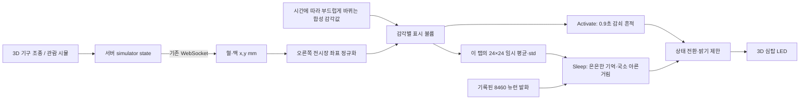
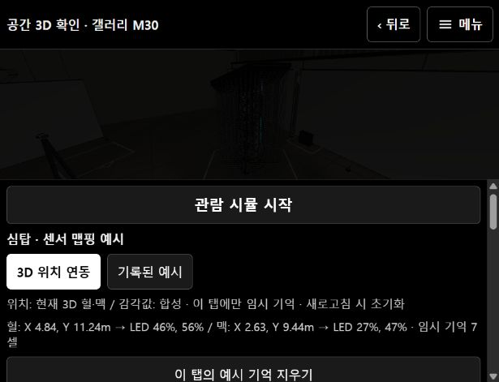
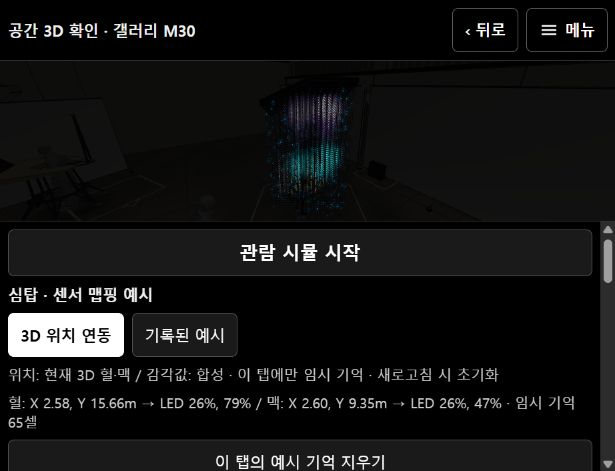

# 3D 혈·맥 위치 → 심탑 연동

[공간 3D](http://127.0.0.1:8000/venue3d?test)의 기본 입력은 **3D 위치 연동**이다.
화면에서 실제로 움직이는 혈·맥의 위치를 사용하고, 라이다·천장·마이크 값만 합성한다.

## 조작

1. **3D 위치 연동 → 예시 Activate**를 선택한다. 아래 기구 조종에서 혈 또는 맥을 골라 움직이거나 기존 관람 시뮬의 이동을 관찰한다.
2. 상단에 각 기구의 현재 전시장 XY(m)와 정규화 LED XY(%)가 표시된다. 혈은 청록 지형/보라 천장 표식, 맥은 따뜻한 음량 기둥이다.
3. **예시 Sleep**으로 바꾸면 이 탭에서 지금까지 관측한 위치의 평균·std와 발화 기록이 나타난다. Sleep에서도 현재 위치의 합성 관측은 계속 쌓인다.
4. **이 탭의 예시 기억 지우기**로 임시 기억만 지울 수 있다. 새로고침하면 기억이 초기화된다.
5. **기록된 예시**는 기존68초 클립으로 돌아간다. 전환 비교 버튼도 기록된 예시를 선택한다. 다시 **3D 위치 연동**을 누르면 현재 위치를 따른다.
6. 위치 연동에서는 과거 위치로 오해하지 않도록 시간 슬라이더를 비활성화한다. 일시정지는 심탑 예시와 임시 관측만 멈추며, 서버의 기구 이동 자체를 멈추지 않는다.

## 입력과 좌표

기존 `/ws/simulator` 상태의 `devices.hyeol.x/y`, `devices.maek.x/y`만 읽는다. 단위는 mm.
`heading`, 실제 라이다/마이크/RSSI는 이 모드에서 사용하지 않는다. 서버로 추가 명령이나 센서 POST를 보내지 않는다.

- 공간: M30 오른쪽 전시실. X=[−0.462,11.149]m, Y=[0.090,19.851]m.
- `u=(x/1000−xmin)/(xmax−xmin)`, `v=(y/1000−ymin)/(ymax−ymin)`.
- 표시 볼륨 XY=[0,31], 기억24×24셀. +M30 X/Y는 +LED X/Y이며 3D 스트립의 행 방향 반전을 보정한다.
- 범위 밖, 다른 전시장, 결측 좌표는 임의로 가장자리에 붙이지 않는다. 상태를 알리고 새 흔적/관측을 만들지 않는다.
- 연결 해제 통지를 받으면 새 관측을 멈추고 기존 Activate 흔적은 감쇠한다. 서버는 변화가 있을 때만 상태를 보내므로, 정지한 기구의 마지막 위치는 연결 중 계속 유효하다.

## 합성 감각과 표시

혈은 `depth_0..8` 0.3–3.7m, `coverage_0..8` .72–1, `ceiling_0` 1.2–3.7m;
맥은 `mic_level_0..2` .08–.90이다. 시드가 있는 난수 값을 시간 보간하여 갑작스러운 프레임 잡음 대신 부드럽게 변한다.
위치는 난수 경로로 만들지 않는다.

센서별 형상과32×32×24 Gaussian 공간 보간은 Python 맵핑과 수치 비교로 확인했다.
Activate 흔적은0.9초 감쇠하며, 각 셀의1초 특징 평균으로 mean/M2/n을 갱신한다.
Sleep 기억 밝기.72, std 강도.45, 시간상수3.2초를 사용한다. 관측1회/분산0이면 임의로 아른거리지 않는다.
브라우저의 국소 잡음은8×8×6 격자를 보간하는 구현이므로 Python의 잡음장과 프레임별 난수가 같은 것은 아니다.

Sleep의 발화는 기존 gain9.5/8460뉴런 기록과0.65초 잔광만 분리한680프레임을 반복한다.
이전 녹화의 센서 기억이나 이동 경로를 합성하지 않는다. 별도 실시간 신경망 계산이나 방사형 파동을 추가하지 않는다.
넓은 중앙부에서 시작해 중간부터 퍼지는 전환과 채널96/전체가중평균18의 표시 상한을 유지한다.

## 임시 기억과 파일

이 탭의 메모리에서만 관측을 유지한다. `localStorage`, IndexedDB, 현장 SQLite, 파일 기록, USB 송신을 하지 않는다.
셀 수는 두 기구×24×24=최대1,152개이며 원시 영상/음성/이동 경로 전체를 저장하지 않는다.
연동 모드를 벗어난 동안에는 이 임시 관측을 추가하지 않는다.

`ripples-example.json.activity_clip`은 gzip+base64로 압축한 발화 전용 RGB이다.
해시·프레임 수·8460샘플·해제 길이를 확인한다. 기존 두 RGB와 함께 해제한 원시 픽셀은 약51.8MB이며,
브라우저/3D 버퍼 등 추가 메모리는 별도다. 시간에 따라 파일 용량이 늘어나지 않는다.
정적 웹판 내보내기도 같은 JS/JSON 자산을 포함하므로 그 웹판의 로컬 시뮬 위치를 따른다.

| Activate: 현재 위치 | Sleep: 이 탭의 위치별 기억 |
|---|---|
|  |  |

[감각별 맵핑](SENSOR_MAPPING.md) · [전환](STATE_TRANSITIONS.md)
