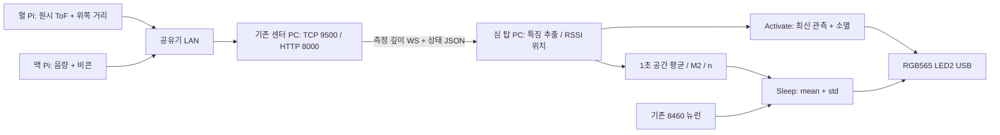

# 공유기 → 센터 → 심 탑 실시간 입력

## 실행 중인 센터와 테스트 화면

2026-11-20 확인한 센터는 이 PC의 `C:\Users\Admin\tof-web-viewer`이다.
그 폴더는 Git checkout이 아니다. 이제 같은 센터/감각기구 소스가 `exhibition-server/`,
`sensors/`에 합쳐졌다(커밋 c7b1b89). 아래 어댑터는 해당 송신·수신 계약에 맞춘다.
collector의 5초 무응답 복구 수정은 로컬 파일에도 백업 후 반영했다. 사용자 권한 승인 후
관리자 권한 서버를 재시작했고 카메라 연결 복구 및 비콘 좌표 유지까지 확인했다.
기구 화면·프리셋·출력 매핑과 Pi 배포 파일을 덮어쓰지 않는다.

**현재는 [수신 전용 점검](RECEIVE_ONLY.md)만 운영한다.** 아래 통계/표시 경로는 추후 선택 기능이다.
`ripples.receive`는 DB·모델·LED를 열지 않는다. `ripples.live`도 기본은 누적 OFF이며,
명시적인 `--accumulate` 없이는 공간 DB를 읽거나 쓰지 않는다. 추가 방사형 파동은 기본 OFF(activity)다.

| 주소 | 역할 |
|---|---|
| `http://127.0.0.1:8000/?test` | 시각화 작업실. 레이어·프리셋, 기구/블라인드 화면 배정 |
| `http://127.0.0.1:8000/operator?test` | 연결 관리. ToF FPS, 거리 Hz, 마이크, 비콘 수신기·노드 상태 |
| `/display/hyeol`, `/display/maek` | 기구 화면 |
| `/display/blind?space=a&clean` 또는 `space=b` | 공간별 블라인드 화면 |
| `/status`, `/inputs`, `/api/beacon` | 심 탑이 읽는 JSON 상태 |
| `/ws/monitor` | 출력 프리셋과 독립인 측정 깊이 WebSocket |

`?test`는 편집/진단 UI 표시이며 mock 모드가 아니다. 실제 여부는 `/status.mock`과
`/inputs.mock`으로 확인한다. 브리지는 mock 센터 데이터를 실측 DB에 넣지 않는다.
센터 `/inputs.hyeol`의 부착 상태는 현재 `simulated:true, applied:false`일 수 있다.
이 값을 근거로 심 탑의 Activate/Sleep을 자동 전환하지 않고 state 파일을 사용한다.



공유기는 네트워크 전달 장치다. 센터와 심 탑이 같은 PC면 loopback을 사용한다.
별도 PC면 `--center http://센터_LAN_IP:8000`으로 지정한다. 인터넷 접속은 불필요하지만
LAN 연결은 필요하다. 센터와 심 탑이 별도 PC이면 모니터 capture 시각 검사를 위해 두 PC의
시각을 맞춘다. raw Pi 입력은 Pi의 wall clock과 PC 시각을 비교하지 않는다.
기존 TCP9500은 센터가 사용 중이므로 심 탑이 같은 포트를 다시 열지 않는다.

## 실제 입력 규격과 LED 대응

| 신호 | 현재 계약 | 심 탑 처리 |
|---|---|---|
| 혈 원시 카메라 | 240×180, depth `<u2` mm + confidence `<u2`, 약 10 Hz | 유효 화소 검사, 회전, 3×3 영역 거리 median·유효 비율 |
| 혈 위쪽 거리 | 포인트 **1개**, `id=0`, `distance_mm`, `valid`, `status` | m로 변환. status=255/invalid/0/60m 이상 제외, 혈 XY의 보라 끝점 |
| 비콘 | 수신기별 nodes, `median_dbm`, `age_ms`, `n`, `state` | 확정 좌표 5개, 신선한 노드 3개 이상. 현재 상대 RSSI 가중 위치 / RF 보정 후 거리 모델 |
| 맥 현재 실시간 | `/api/maek`: `v:1`, `device`, `seq`, `mics:[L,C,R]` 각 0..1 | `mic_level_0..2`, 낮은 층 베이지 3점. 주파수·dBFS가 아님 |
| 맥 원시 음성 선택 경로 | 44.1kHz, 16bit signed LE, 3채널 interleaved PCM | PC에서 DC 제거, RMS 전력·Hann FFT, 저/중/고 대역 추출 |

현재 센터의 `/api/maek`는 direction/haptic/rms도 받을 수 있으나 측정 축·보정 규격이
확정되지 않아 심 탑 공간 방향 표상에는 쓰지 않는다. `pitch_hz`는 실제 경로에서 null이다.
합성 pitch/방향을 측정한 주파수로 사용하지 않는다. PCM은 저음 <400Hz, 중음 400–2000Hz,
고음 ≥2000Hz의 기존 색/높이/밝기를 사용한다. Activate/Sleep 양쪽에 같은 규칙을 적용한다.

### 센터 브리지: 지금 실행 가능한 경로

`/ws/monitor`에 연결하고 프레임을 받은 다음 `next`를 보내 한 프레임씩 받는다.
헤더는 `<4sBBHHIdfHHBBHHBBH>`: TOF3, mode, flags, width, height, frame_id,
capture_ms, center_mm, near, far, line, row, gain, interval, base, padding, flow.
mode=0(sensor) 뒤 `height×width` uint16 LE 깊이, 이후 선택 POSE/EDGL 부록은 무시한다.
센터 odometry 좌표를 비콘의 실제 세계 XY로 혼용하지 않는다.

이 깊이는 **센터 PC에서 confidence 마스킹과 방향 보정을 이미 한 데이터**다.
Pi 전처리가 필요하지 않다. 출력용 contour/temporal/relief 프리셋과 독립이며,
심 탑은 다시 회전하지 않고 3×3 특징을 만든다. 원시 confidence는 WS에 포함되지 않는다.
따라서 `monitor_confidence`(점검 당시 30)와 `/status.confidence`가 다르면 ToF를
실측 통계에 넣지 않는다. 재현 가능한 보정을 바꿀 때는 새 설정/DB를 사용한다.

상태 JSON은 목표 10Hz, 한 번에 한 요청 묶음만 처리한다. 동일 seq를 반복 표시/누적하지 않는다.
실시간 거리·맥은 age<0.5s인 새 값만 사용한다. 연결만 있고 value=null이면 결측이다.
ToF의 PC 시각이 현재보다 `max_sensor_age_s`(기본 0.5초) 이상 다르면 제외한다.
네트워크 오류는 status에 기록하며 재연결한다. 입력 중단 시 새 흔적이 찍히지 않아
Activate가 감쇠한다. Sleep의 기존 기억과 reservoir 계산은 계속된다.

### Pi → 심 탑 원시 TCP 선택 경로

센터의 raw 카메라 경로를 별도로 구성할 때 사용한다. 기존 송신 목적지를 자동 변경하지 않는다.
Pi의 depth/conf 포장과 TCP 송신만 필요하며, 필터·영역 축약·FFT는 심 탑에서 한다.

```powershell
# 예시: 실제로 할당된 심 탑 LAN IP를 넣는다. 9501/9502는 각기 별도 연결.
python -m ripples.live --config runtime/live-site.json --bind 192.168.0.10 --collector-port 9501 --audio-port 9502 --seconds 0
```

센터 브리지로 비콘은 계속 받는다. `--collector-port`는 중복 축적을 막기 위해 센터의
ToF/거리 수집을 끄고 raw 혈 입력을 사용한다. `--audio-port`는 센터 음량 대신 raw PCM을
사용한다. 각 listener는 한 송신기를 받으며 연결이 끊기면 다음 연결을 수락한다.
송신기도 연결 실패 시 재시도해야 한다. 방화벽 허용은 지정한 LAN 수신 포트에 한한다.

한 메시지: `[JSON 길이 u32 LE][바이너리 길이 u32 LE][UTF-8 JSON][바이너리]`.
헤더 최대 64KiB, payload 최대 2MiB. TCP 부분 수신을 합쳐 정확한 길이까지 읽는다.
시작 메시지 `{"type":"hello","version":1,"role":"hyeol","rotate":180}`.
기존 혈 hello의 role 생략은 hyeol로 해석한다. hello 이후:

```json
{"type":"tof","seq":1,"t_wall_ns":1790000000000000000,"t_mono_ns":1000000000,"width":240,"height":180,"depth_dtype":"<u2","conf_dtype":"<u2"}
```

예시 시각은 실제 전송 시 현재 capture 시각으로 바꾼다. payload는 depth 전체 다음 conf 전체,
각 86,400 bytes, 합계 172,800 bytes. confidence≥60, 0<depth≤4000mm만 사용한다.
카메라 설치 회전은 hello.rotate 또는 설정 rotate로 **한 번만** 적용한다.
lidar는 payload 없이 `type,seq,t_wall_ns,t_mono_ns,id:0,distance_mm,status,valid`를 전송한다.

맥 전용 연결은 hello에 `role:"maek"`, 다음 형태의 확장 메시지를 사용한다:

```json
{"type":"audio","seq":1,"t_wall_ns":1790000000000000000,"t_mono_ns":1000000000,"sample_rate":44100,"channels":3,"dtype":"<i2"}
```

payload는 WAV 파일 헤더 없는 PCM. 최대 1초, 권장 0.1초=4,410 frames=26,460 bytes.
`t_wall_ns`/`t_mono_ns`는 해당 블록 마지막 샘플 시각으로 보낸다. 1초 블록은 그만큼 지연되므로
Activate에는 100ms 블록이 적합하다. 같은 연결에서 type별 seq가 증가해야 한다.
이 PCM 확장은 심 탑 수신 기능이며 **현재 맥 Pi 펌웨어가 이미 송신한다는 뜻은 아니다**.
기존 Pi는 현재 센터 음량 경로를 먼저 사용하고, PCM sender 연결은 별도 배포해야 한다.

raw 수신은 연결별 `t_mono_ns`의 진행 간격과 PC 수신 단조 시각을 비교해 누적 지연을 검사한다.
최소 관측 전달 오프셋보다 0.5초 이상 밀리거나 source clock이 되돌아가면 연결을 닫아
최신 송신으로 재접속하게 한다. Pi wall clock이 몇 년 틀려도 그 이유만으로 버리지 않는다.
첫 패킷의 절대 전달 지연은 동기화 없이 알 수 없다. `t_mono_ns` 없는 기존 PCM 확장은
수신 시각만 사용하며 `arrival_only_raw`로 표시한다. 과거 녹화 파일을 이 live 포트로 재생하지 않는다.

## 확정된 M30 좌표와 대략적인 위치

2026-11-20 사용자 확정, 센터 `/api/simulator.layout.beacons`와 디스크의
`data/m30/simulator.json` 값이 같음을 확인했다. 단위 mm를 m로 변환해
[`configs/live.m30.json`](../configs/live.m30.json)에 저장했다.
후속 업로드 5d97836의 [`beacons.json`](../exhibition-server/venues/m30/beacons.json)과도
5개 값이 모두 일치한다. 로컬 센터의 기본 배치 코드/파일도 이 버전과 일치한다.

| 노드 | X(m) | Y(m) |
|---|---:|---:|
| 1 | 9.933 | 10.526 |
| 2 | 9.419 | 18.456 |
| 3 | 1.541 | 14.387 |
| 4 | 1.525 | 6.472 |
| 5 | 6.511 | 1.020 |

원점은 X3·Y7 교점, +X는 X3→X5, +Y는 Y7→Y3. 전체 M30(로비 포함)의
X `[-10.770,11.149]`, Y `[-0.100,19.851]`m를 LED XY 범위로 대응한다.
현재 비콘은 주 전시실에 모여 있으며, 관측되지 않은 로비를 채우지 않는다.
센터의 z=0은 실제 설치 높이를 측량했다는 뜻이 아니므로 XY 추정에 사용하지 않는다.

사용자 선택에 따라 **RF 미보정 상대 RSSI 위치**를 먼저 사용한다. 감쇠 지수 n=4,
`w_i=10^((RSSI_i-max(RSSI))/(5n))`, `XY=sum(w_i*anchor_i)/sum(w_i)`이다.
이는 거리비의 역제곱에 해당하는 가중 중심이며, RSSI의 공통 offset에 영향을 받지 않는다.
실제 거리나 정밀 좌표를 복원한 결과가 아니고, 비콘 사이 중앙 쪽으로 치우칠 수 있다.
`reference_dbm:-59`는 이 모드에서는 쓰지 않는 보정용 자리값이다.

`position_mode=relative_rssi`, `coordinates_confirmed=true`, `calibrated=false`를 구분한다.
향후 `--accumulate`를 켠 경우에만 추정 위치 통계를 `runtime/m30-relative.sqlite3`,
namespace **estimated**에 저장한다. 현재 수신 전용 실행에서는 이 DB를 열지 않는다.
새 비콘/공간 설정을 화면에서 바꿔도 운전 중 DB의 좌표 기준은 자동으로 바꾸지 않는다.
검토한 새 설정은 아래로 내보낼 수 있다(기존 파일 덮어쓰기 금지).

```powershell
python -m ripples.site --output runtime/m30-next.json
```

원래 `range_fit` 방식으로 전환하려면 각 노드 1m RSSI와 알려진 위치의 오차를 보정한 후
`position_mode=range_fit`, `calibrated=true`로 변경하고 **새 measured DB**를 사용한다.
과거 estimated 셀을 실측/보정 완료 셀로 다시 이름 붙이지 않는다.

## 비콘 위치 설정

`configs/live.example.json`은 다른 장소/수신 진단용 **미보정 템플릿**이다. 명시적으로 이 파일을
선택하면 수신/특징 추출만 하고 좌표나 DB 기록을 만들지 않는다. 기본 M30 운전은 위의
`live.m30.json`으로 5개 노드를 사용한다. 설정에 없는 노드는 위치 계산에서 제외한다.

1. `anchors`에 실제 노드 번호, 같은 기준축의 XY(m), 각 노드의 1m RSSI(dBm)를 입력한다.
2. `bounds_m`을 `[[xmin,xmax],[ymin,ymax]]`로 입력한다. 이 범위를 LED 전체 XY에 선형 대응한다.
3. `receivers`를 실제 수신기 이름에 맞춘다. 확인 당시 혈 `ripples-tof`, 맥 `mic`이다.
4. 현장에서 알려진 위치들과 비교하고 `max_residual_m`을 정한 뒤 `calibrated:true`로 바꾼다.
5. 설정/입력 경로가 바뀌면 별도 `--db`를 쓴다. fingerprint로 기존 보정과 섞이지 않게 한다.

RF 보정 후 range_fit 거리 모델은 `P_mW=10^(RSSI/10)`, `d=10^((reference-RSSI)/(10×4))`이다.
센터 operator의 기본 거리 지수 2는 쓰지 않고 median RSSI를 읽어 다시 계산한다.
노드 state=OK, n>0, 유효 median, `노드 age + 센터 수신 후 시간 <3s`를 만족해야 한다.
두 모드 모두 최소 3개의 비공선 노드가 필요하다. range_fit은 거리 잔차 RMS도 검사한다.
상태 STALE의 null age/median/n은 해당 노드만 제외하고 나머지 정상 노드는 계속 사용한다.
RSSI는 벽·몸·반사 영향을 받으므로 이것은 위치 추정이며 정밀 측위가 아니다. 서로 같은
높이라는 근사와 1.5초 RSSI median/최신 센서의 시간 차이가 있다. 세계 방향·점군 재구성은 별도다.

## 지연·누적·용량 (누적은 opt-in)

- 수신/특징 추출, SQLite/공간장 생성, LED 렌더링을 분리한다. LED 루프에서 네트워크나 DB를 기다리지 않는다.
- 표시 대기는 신호 종류별 최신 1개. raw 처리 대기도 type별 최신 1개이며 밀린 값은 병합한다.
  `visual_coalesced`/`raw_coalesced`에 횟수를 남긴다. 표시에서 건너뛴 처리 완료 특징도 통계 큐에는 보낸다.
- 통계 큐는 최대 2,048개. 넘치면 `memory_queue_drops`에 기록한다. 과부하에서 모든 원본을 보존한다고 약속하지 않는다.
- 1초의 각 공간 셀/센서/특징별 합·개수를 구한 뒤 완성된 초의 평균으로 Welford mean/M2/n을 갱신한다.
  raw frame 파일은 저장하지 않는다. DB 오류가 나면 live 실행을 오류로 종료해 저장 실패를 숨기지 않는다.
- 단일 SQLite 소유 스레드, 보정당 고정 import cursor 1개. 재시작 시 이미 저장한 초를 중복 합산하지 않는다.
  재시작 경계의 나머지 같은 초는 제외될 수 있다. 전원 손실 시 commit 전 마지막 초/큐는 유실될 수 있다.
- 2초마다 메모리장을 비동기로 갱신한다. Activate에도 데이터는 계속 누적되며 Sleep은 최신 mean/std를 표시한다.
- 기존 DB 256MiB 한도, 여유 공간 512MiB, 최근 30일과 평생 통계 정책을 유지한다. WAV/ToF를 원본으로
  계속 녹화하면 각각 약 22.86GB/일, 149.30GB/일이므로 이 경로는 특징 통계를 보존한다.
- 이 TCP는 live stream이며 원본 파일 보관 ACK가 없다. 기존 WAV 업로드의 `stored:true` 계약을 대신하지 않는다.
- 8,460 뉴런, gain9.5, dt0.1ms, 프레임당40스텝을 유지한다. 센서가 reservoir를 재튜닝하지 않는다.

`runtime/live-status.json`은 고정 파일을 갱신한다. `errors`, `positions_available`,
`unpositioned`, `memory_error`, `memory_queue_drops`, `loop_fps`를 점검한다.
USB는 `--port`와 보드 확인 후에만 열고, 실제 성능은 보드 완료 ACK FPS로 판단한다.
센터 `/api/sim/frame`의 `(12,16,64,3)` 화면 프로토콜은 현재 설치 `(12,16,65,3)` LED2와
다르므로 이 브리지는 그 endpoint로 프레임을 보내지 않는다.

## 연동 기준 파일

첫 연동 확인 시점 SHA256. 이후 센터 코드는 c7b1b89로 합쳐졌으며 collector_client.py의
로컬 디스크는 저장소의 5초 복구 버전과 일치하며, 서버 재시작으로 실행 프로세스에도 반영했다.

| 파일 | SHA256 |
|---|---|
| server.py | `0220635f2caa9438c1edef0ba261fd8754577862a97ef105d729c317da763c30` |
| collector_protocol.py | `4afcecf6b02c3d3009b390f27720960b70e8f478e32fc59c868dd06c9a6ffc86` |
| collector_client.py | `46a9f3fb2a18312e6d3c7879504a2fba484ae65c5a62173c9e34966dcb0d0ccc` |
