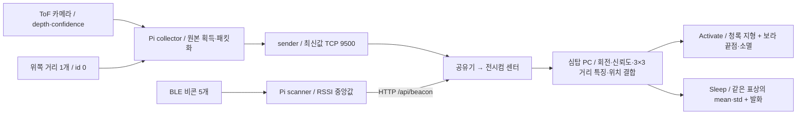

# 감각기구 — 혈

혈은 **카메라가 바라보는 거리의 분포와 위쪽 한 점의 거리**를 감각합니다. 비콘은 혈이 전시장 어디에 있는지 추정하는 데 사용합니다. 카메라의 9개 구역은 서로 다른 기구가 아니라 하나의 혈 위치에 묶인 감각입니다.

## 기구에서 다루는 데이터

| 입력 | 내용 | 현재 LAN 전송 |
|---|---|---|
| ToF 카메라 | 240×180 depth uint16 LE **mm** + confidence uint16 LE | 약 10Hz, depth 전체 뒤 confidence 전체, 프레임 172,800B |
| 위쪽 라이다 | `id=0`, `distance_mm`, `valid`, `status` | 약 50Hz, 바이너리 없는 JSON 헤더 |
| 비콘 | 노드 1–5의 RSSI **dBm**, 수신 시각·장치 ID | 수신기 `ripples-tof`, 약 1Hz HTTP 집계 |

collector만 센서를 열고, sender가 최신 데이터에 `seq`, `t_mono_ns`, `t_wall_ns`를 붙여 전달합니다. Pi에서 LED용 영상 분석이나 3×3 공간 축약을 수행할 필요가 없습니다. Pi의 센서 수집, 선택적 로컬 저장, 자체 화면은 심탑의 전처리와 별도입니다.

TCP 메시지는 `[JSON 길이 u32 LE][payload 길이 u32 LE][UTF-8 JSON][payload]`입니다. 연결 시작에 `hello/version:1/rotate`를 보냅니다. sender는 연결이 끊기면 재접속하며, 오래된 프레임을 계속 밀어 보내지 않습니다. [원시 파일 규격](collector/DATA_FORMAT.md)과 [네트워크 계약](../../docs/realtime.md)에 세부 필드가 있습니다.

## 심탑 PC에서 하는 전처리

1. 패킷 길이·dtype·seq·신선도를 확인합니다. raw 경로에서는 설치 회전을 한 번 적용합니다.
2. raw confidence ≥60, 0 < depth ≤4000mm인 화소만 사용합니다. 센터 WS 경로는 센터에서 회전/마스킹을 마쳤으므로 다시 회전하지 않고, 설정된 confidence 기준과 일치하는지도 확인합니다.
3. 영상 3×3 각 구역에서 유효 깊이의 **중앙값(m)**과 **유효 화소 비율(0–1)**을 만듭니다. 유효 화소가 없는 구역은 거리값을 만들지 않습니다.
4. 위쪽 거리는 valid이고 status≠255인 `id=0`만 m로 변환합니다. 0 또는 60m 이상은 제외합니다.
5. 혈 비콘 위치가 유효할 때만 특징을 공간 XY에 붙입니다. 위치가 없으면 수신 상태는 보이지만 가짜 좌표를 찍지 않습니다.

현재 기본 경로는 센터 PC에서 회전·confidence 마스킹, 심탑 프로그램에서 영역 특징 추출입니다. 두 프로그램이 전시컴에서 함께 동작하므로 이 영상 처리를 라즈베리파이에 요구하지 않습니다. 심탑 raw TCP 선택 경로는 모든 단계를 심탑 프로그램에서 처리합니다.

## LED에 남기는 표상

- 혈 XY 주변의 **청록색 3×3 연결 면**: 0–4m를 고정 로그 높이 축(z=0.12–0.58)에 대응해 가까운 거리 차이를 확대합니다. 가까우면 더 밝고 coverage가 낮으면 약해집니다. 결측 구역을 연결하지 않습니다.
- 혈 XY 중심의 **상단 보라색 기둥과 가로 표식(z=0.72–0.94)**: 위쪽 라이다 하나의 거리입니다. 유효 범위가 60m 미만이어도 표시 높이는 4m에서 포화합니다.
- Activate에서는 최신 감각을 찍고 감쇠시킵니다. Sleep에서는 같은 위치 셀의 같은 특징 평균과 표준편차를 같은 규칙으로 표현합니다.

카메라 자세의 세계좌표 보정은 아직 없으므로 3×3 패턴은 LED 좌표에 고정된 특징 표현입니다. 기구의 회전을 복원한 벽 지도나 실제 천장 높이 지도라고 해석하지 않습니다.

[전체 데이터 흐름](../../docs/DATA_FLOW.md) · [심탑 처리](../../src/ripples/README.md) · [기존 설치·운영 참고](OPERATIONS.md)
