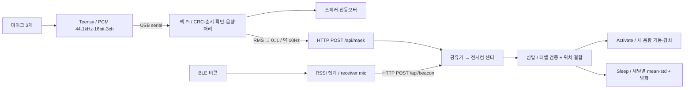

# 감각기구 — 맥

맥은 **마이크 3채널의 소리**를 감각합니다. 비콘으로 맥의 위치를 추정하고, 심탑은 그 위치에 소리의 특징을 표시합니다. 3개 마이크는 하나의 맥 기구에 속합니다.



## 현재 실제 전송 형태

Teensy→Pi 원음은 44,100Hz, signed int16 little-endian, 3채널 interleaved입니다. 패킷에는 seq, 샘플레이트, 프레임 수, 채널 수와 CRC32가 있습니다. Pi는 이를 검증하고 로컬 스피커·진동 처리를 수행합니다.

**현재 LAN으로는 원음이 아니라 음량 요약을 보냅니다.** `maek_runtime/simlink.py`의 전송 형태는 다음과 같습니다. 아래 값은 설명용입니다.

```json
{"v":1,"device":"mic","seq":1203,"t":1794990142.31,
 "mics":[0.445,0.246,0.457],"rms":[0.0041,0.0013,0.0044],
 "haptic":[0.35,0.30],"level_bias":0.05,"direction_deg":null}
```

| 필드 | 의미 | 심탑의 현재 사용 |
|---|---|---|
| `mics[3]` | L/C/R 정규화 음량 0–1 | 세 기둥의 높이·밝기, 평균·std |
| `rms[3]` | Pi 대역 처리 후 디지털 RMS | 송신 규격 참고; 현재 센터 브리지는 mics를 사용 |
| `haptic[2]` | 진동 목표 세기 | LED 표상에 사용하지 않음 |
| `level_bias` | 좌우 레벨 차, −1..1 | 실제 각도가 아니므로 위치/방향으로 쓰지 않음 |
| `direction_deg` | 보정된 방향이 없으면 null | 가짜 방향을 만들지 않음 |
| `seq`, `t` | 순서, 송신기 시각 | 중복 방지; 신선도는 센터 수신 age로 판단 |

현재 기본 정규화는 `dBFS = 20 log10(max(RMS, 1e-7))`, `mics = clip((dBFS+70)/50, 0, 1)`입니다. **−70dBFS→0, −20dBFS→1**이고 실제 음압 dB SPL 보정이 아닙니다. 설정을 바꾸면 같은 밝기의 뜻이 달라지므로 전시 중 고정하며 통계 DB를 분리해야 합니다. 맥 Pi의 gain/필터 변경은 심탑이 자동 검출할 수 없습니다.

sender는 별도 스레드의 최신값 한 칸을 사용해 네트워크가 느려져도 오디오 처리를 막지 않습니다. 실패한 옛 음량을 나중에 재생하지 않습니다. 비콘은 별도 scanner가 `receiver=mic`으로 약 1Hz 보냅니다.

## 원시 PCM을 심탑에 보낼 때의 선택 경로

심탑은 PCM16 LE / 44.1kHz / 3ch raw TCP 수신을 지원합니다. 100ms 블록은 4,410프레임, 26,460B입니다. 이 연결은 **현재 맥 Pi sender에 배포된 기능이 아닙니다.** 원음을 송신하도록 연결한 뒤 심탑에서 아래 작업을 수행합니다.

1. 패킷·채널·길이·seq 검증, int16 /32768 → 디지털 진폭.
2. 채널별 DC 제거 → 선형 평균제곱 전력.
3. Hann FFT → 저음 <400Hz, 중음 400–2000Hz, 고음 ≥2000Hz의 전력. 반대 위상 마이크가 상쇄되지 않도록 파형 대신 채널 전력을 평균합니다.
4. 통계는 **선형 전력**으로 누적하고, 표시할 때만 `clip((10 log10(power)+60)/54,0,1)`로 밝기를 만듭니다.

현재 음량 3채널을 저·중·고 주파수로 바꾸어 표시하지 않습니다. 두 입력 방식은 설정 fingerprint로 구분하고 기존 DB에 섞지 않습니다.

## 위치와 LED 표상

현재 mics는 맥 XY에 묶인 **따뜻한 색의 L/C/R 세 음량 기둥**입니다. PCM 선택 경로는 같은 XY의 낮은 호박색·중간 산호색·높은 자홍색으로 주파수 특징을 표시합니다. 음량이 커지면 기둥의 높이와 밝기가 함께 커지고 0이면 꺼집니다. PCM은 세 높이의 띠 너비와 밝기로 전력을 표현합니다. 높이는 실제 음원 높이가 아닙니다.

Activate는 최신값의 흔적이 사라지고, Sleep은 같은 변환을 적용한 공간 셀의 평균과 std가 아른거립니다. 두 상태 모두 수신은 계속되며 누적 ON이면 관측을 계속 기억합니다.

[전체 흐름](../../docs/DATA_FLOW.md) · [심탑 처리](../../src/ripples/README.md) · [세부 JSON 규격](docs/SIM_FORMAT.md) · [기존 운영 참고](OPERATIONS.md)
