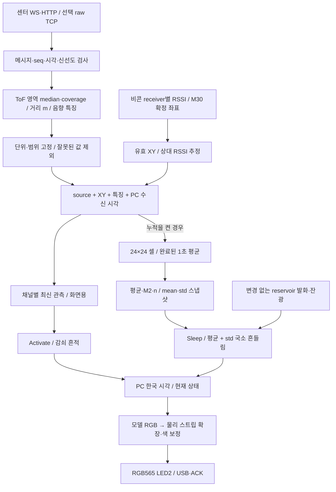

# 심탑 — 실시간 감각과 공간 기억

심탑 프로그램은 전시컴에서 혈·맥의 신호를 받고, 같은 공간 기준으로 정리한 뒤 LED에 표현합니다. **수신은 계속, 표시는 시간표에 따라** 동작합니다. 설치 명령보다 처리 원리와 책임을 중심으로 설명합니다.

## 한 관측이 LED까지 가는 과정

### 실시간 수신과 정리

센터 경로는 `/ws/monitor`의 깊이와 `/status`, `/inputs`, `/api/beacon`의 JSON입니다. raw 선택 경로는 TCP로 depth/conf 또는 PCM을 받습니다. raw는 최신 패킷만 전처리해 오래된 큐를 재생하지 않습니다. 센터 경로의 카메라 회전·confidence 처리는 이미 PC 센터에서 수행했고 심탑은 다시 회전하지 않습니다.

내부 이벤트는 `source(hyeol/maek)`, `xy([-5,5]²)`, `features(단위가 정해진 특징)`, `t(PC 수신 epoch초)`입니다. raw의 source clock은 지연·순서 검사에 별도로 사용합니다. 매 프레임 화면에는 채널별 최신 관측만 전달하고, 누적 ON이면 채택된 관측은 별도 기억 작업자로 전달합니다.

비콘이 부족하면 수신 자체는 계속하지만 공간 이벤트를 만들지 않습니다. 끊긴 신호를 마지막 위치에 영원히 찍거나 0거리/0음량 관측으로 누적하지 않습니다. `runtime/live-status.json`은 현재 상태·다음 전환 시각·누적 여부·수신/드롭 수·오류·위치 유효성·PC FPS를 보고합니다. 원시 녹화 파일은 만들지 않습니다.

### M30 공간 대응

좌표는 X3/Y7 교점 원점, +X는 X3→X5, +Y는 Y7→Y3입니다. **로비를 제외한 오른쪽 전시실** X `[-0.462,11.149]`, Y `[0.090,19.851]`m를 LED 수평면 전체에 선형 대응합니다. 이는 M30 바닥 도면의 오른쪽 직사각형 경계입니다. 범위 밖 입력은 가장자리로 강제 이동시키지 않고 제외합니다. 전시실 전체가 표상 범위라는 뜻이며 미관측 공간을 가짜 관측으로 채우지는 않습니다.

비콘 1~5는 각각 `(9.933,10.526)`, `(9.419,18.456)`, `(1.541,14.387)`, `(1.525,6.472)`, `(6.511,1.020)`m입니다. [설정](../../configs/live.m30.json)에 좌표를 고정했습니다.

1m RSSI는 아직 미보정입니다. 현재는 감쇠 지수 4, `wᵢ=10^((RSSIᵢ−maxRSSI)/20)`의 상대 가중 중심을 사용합니다. 거리비의 역제곱 가중치이며 정밀 삼각측량이 아닙니다. 최소 3개 유효·비공선 노드가 필요하고, 관측하지 않은 영역을 채우지 않습니다. 향후 거리 보정 통계와 현재 estimated 통계는 섞지 않습니다.

LED의 X/Y 방향은 논리적으로 전시장 X/Y와 맞춥니다. 실제 탑의 설치 heading을 자동 회전 적용하지 않았으므로 물리 방향 일치는 현장 기준점 확인이 필요합니다. 카메라 구역/마이크 채널은 위치에 묶인 특징이며 세계 방향을 복원한 결과가 아닙니다.

## 두 상태의 공통 맵핑

| 특징 | 정규화 / 표상 |
|---|---|
| `depth_0..8` (m) | 카메라 3×3 청록 지형, `z=0.12+0.70×clip(d/4,0,1)` |
| `coverage_0..8` (0–1) | 유효 비율, 거리 끝점 세기 `0.22+0.78√coverage`; coverage=0이면 점 없음 |
| `ceiling_0` (m) | 혈 XY 중심 보라선/끝점, 같은 4m 높이 범위 |
| `mic_level_0..2` (0–1) | 맥 XY의 낮은 층(z=0.10) 베이지 3점; 값이 밝기 |
| `band_low/mid/high` (PCM 선택 경로) | z=0.18/0.46/0.74, 호박/산호/자홍; 선형전력의 dBFS로 밝기 |

이 값은 32×32×24 표시 볼륨에 놓고 부드럽게 공간 보간한 뒤 실제 LED 위치에서 읽습니다. 표시 볼륨과 기억의 24×24 셀은 역할이 다릅니다. 수직 축은 감각 특징의 표현 축입니다.

Activate는 최신값의 흔적을 약 0.9초 시간상수로 감쇠합니다. Sleep은 각 셀의 같은 특징 평균에 같은 변환을 적용합니다. 2회 이상 관측한 특징의 std를 평균±std 표상의 차이로 변환하고, 시간상수 1.8초의 부드러운 국소 잡음으로 아른거리게 합니다. std는 새 이동체나 방사형 파동을 만들지 않습니다.

## 11시 기준 상태 시간표

[시간표 설정](../../configs/schedule.m30.json)은 Asia/Seoul, 11:00, Activate 20분, Sleep 10분입니다. 11:00–11:20 / 11:20–11:30, 11:30–11:50 / 11:50–12:00처럼 반복합니다. **각 구간은 시작 포함·끝 제외**입니다.

프로그램 시작부터 20분을 세지 않습니다. 매 프레임 실제 한국 시각을 계산하므로 11:24에 켜면 곧바로 Sleep이고, 11:30에는 Activate가 됩니다. 시각이 보정되거나 절전에서 돌아와도 현재 구간을 사용합니다. 폐장 조건은 아직 없으므로 실행 중 하루 전체에 같은 주기가 적용됩니다. 센서 시간과 신경망 시뮬레이션 시간은 이 상태 계산과 분리합니다.

`ripples.live` 기본은 **scheduled·연속 실행**입니다. 수동 모드는 `--state-mode manual`, 또는 명시적 `--state activate/sleep`로 선택합니다. 수동 모드에서만 `runtime/state.txt`와 기존 activate/sleep 스크립트가 동작합니다. scheduled와 고정 state를 동시에 요청하면 모호하게 처리하지 않고 오류로 알립니다. 기록 재생 앱 `ripples`와 나란히 비교 GIF는 전시 live 시간표를 자동 사용하지 않습니다.

전환은 표시 선택만 바꾸며 수신 연결·기억·신경망을 유지합니다. Sleep 동안 받은 최근 신호도 계속 수집하고, 다음 Activate에는 최근 감각부터 나타납니다. 출력 큐에 이미 들어간 USB 프레임의 전송 지연은 있을 수 있습니다.

## 공간 기억과 용량

누적 ON일 때 두 상태 모두 같은 처리입니다. 같은 셀·센서 특징의 1초 관측을 평균한 후 mean/M2/n을 갱신합니다. Sleep의 std는 이 1초 평균들의 표본 표준편차이며, 단순 원시 샘플 전체의 std가 아닙니다. 무관측 특징은 0으로 추가하지 않습니다. 스냅샷은 약 2초마다 갱신됩니다.

통계는 SQLite 트랜잭션으로 보존하고 정상 종료 때 남은 집계를 반영합니다. 갑작스러운 정전은 아직 커밋하지 않은 관측을 잃을 수 있습니다. 원본 전체 복구를 보장하는 아카이브가 아닙니다. 최근 30일/평생 요약, DB 본체 256MiB 한도, WAL 별도, 디스크 여유 512MiB 검사와 오류 보고를 사용합니다. 기억 큐는 2,048개로 제한하고 넘친 수를 보고합니다.

**현재 현장 누적은 OFF 유지**입니다. 전시 표시 앱의 `--accumulate` 선택 시에만 공간 DB를 열고, 두 상태 모두 저장합니다. 누적 OFF는 새 관측도 저장하지 않고 기존 공간 DB도 읽지 않아 Sleep이 신경망 발화만 보여줍니다. 수신 점검 앱 `ripples.receive`는 모델·기억·USB 자체를 열지 않습니다.

## 신경망과 물리 LED

8,460 뉴런(E 6,768 / I 1,692), gain 9.5, dt 0.1ms, 프레임당 40스텝을 유지합니다. 센서가 네트워크에 피드백되지 않고 렌더 단계에서 합성됩니다. 기본 `activity`는 발화 픽셀과 약 0.65초 잔광이며 **추가 방사형 파동 없음**입니다. Sleep의 std 효과와 모델의 실제 집단 발화는 별도 층입니다.

모델 RGB `(12,16,55,3)`를 설치 `(12,16,65,3)`으로 펼치고, 34개 스트립의 R/G를 보정한 뒤 RGB565 LED2로 보냅니다. 가시 LED 10,260개가 각각 독립 뉴런이라는 뜻은 아닙니다. 180개 스트립·물리 10,440개이며 첫 물리 LED는 검정입니다. 포트/보드 확인은 실제 송출 전에 유지합니다.

[전체 네트워크](../../docs/DATA_FLOW.md) · [raw 규격](../../docs/realtime.md) · [하드웨어](../../docs/tower.md) · [M30 예시 폼](../../data_led_example/m30_session/README.md) · [검증](../../docs/validation.md)
